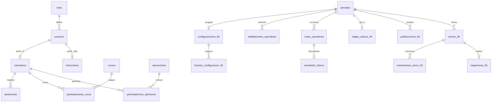

# SICOSE — Bases de desarrollo, reconstrucción limpia y continuidad

**Corte funcional vigente: 2026-10-16, SQLite v25. Bases históricas conservadas: v23/v24.**

SICOSE significa **Sistema de Control y Evaluación de Personal**. Este archivo es una especificación autónoma para reconstruir el prototipo en un repositorio nuevo y continuar desde el alcance alcanzado. Está dirigido a una persona desarrolladora o a un nuevo chat de Codex. No requiere copiar la conversación anterior ni disponer de sus archivos temporales.

El propósito es conservar decisiones y comportamiento, evitando reproducir interfaces duplicadas, permisos antiguos, cálculos ambiguos y migraciones acumulativas innecesarias. Una reconstrucción limpia no es una autorización para cambiar reglas de puntuación, privacidad o roles.

## 0A. Organización vigente del proyecto limpio — v25, 2026-10-15

Este bloque prevalece sobre el capítulo 0 v24 y las descripciones históricas. Reconstruir las cinco entradas con las reglas v3 y aplicar estas correcciones desde el principio:

- Título HTML único SICOSE - SBRAB y favicon del mismo emblema institucional. Mantener azul #1D1BBE, naranja #F57B1A, superficies discretas, tipografía legible, espacios contenidos, filas compactas, controles con nombre accesible y temas claro/oscuro. El directorio de personal conserva su diseño. Solo el registro de asistencia se compacta; su historial conserva medidas/filtros.
- Menú del Jefe: Inicio; Personal y Operaciones (Instructores Voluntarios, Asistencias, Cursos y Capacitaciones, Operaciones); Evaluación Anual (Gestión, Evaluaciones, Reportes). Notas y Resultados no es otra pantalla operativa. Gestionar históricos mediante enlaces contextuales funcionales, no duplicar el flujo nuevo.
- Inicio con tarjetas pequeñas y cuatro gráficos de barras por meses de la Gestión activa no retirada, respetando inicio/fin inclusivos y meses vacíos: operaciones/cursos por inicio, asistencias como días distintos con registros y formación por finalización. Explicitar que son conteos de intervalos, sin tratarlos como calificaciones o predicciones.
- Cursos/Operaciones: registro desplegable nativo del mismo estilo que Agregar Instructor, tablas compactas, edición en modal y selección múltiple por checkbox. Reportes solo en el centro, no duplicar formularios de exportación en cursos.
- Gestión: nombre/inicio/fin, Crear Gestión, edición anterior al inicio, inicio explícito, cierre con instantáneas y reapertura solo administrativa. No mostrar Borrador como acción del producto: internamente BORRADOR identifica una Gestión creada/preparada sin resultados. No cerrar otra gestión automáticamente. Al iniciar, todos los Instructores activos reciben ceros oficiales; inactivos mantienen restricciones. Sin botón de inscripción adicional ni alta automática durante un ciclo ya iniciado. Reabrir no reinicia notas.
- Administrador/Jefe eliminan permanentemente únicamente gestiones sin resultados ni evidencia protegida. Los ceros oficiales son resultados. Transacción con nombre/estado anteriores para concurrencia; auditoría mínima y comprobación FK. No eliminar configuraciones congeladas, habilitaciones históricas, notas, publicaciones o cierres. Los metadatos/eventos de modelos nunca iniciados pueden borrarse junto con la Gestión; el resto permanece inmutable.
- Evaluaciones: tabla de personas y resúmenes pequeños, activación anual/habilitación personal y notas manuales. Física v3 sin fechas, con estado Cumplida/No cumplida y cero obligatorio en esta última. Preservar fechas y trazabilidad del circuito anterior. No borrar los endpoints históricos necesarios para V1/V2.
- Curso sin vínculos: eliminación física. Curso con participación o capacitación histórica: baja inmutable y exclusión operativa, con consulta de archivados. Baja de catálogo no borra participaciones/puntos. Retirada de participantes por checkbox exige motivo/revisión; lote atómico, historial previo completo, vigente No completado sin puntos/fecha, marca Retirado. Recalcular abierto; cierre e inactividad bloquean corrección. Publicaciones conservan su versión hasta republicación explícita.
- Instructor v3 consulta solo sus físicas/Académica habilitadas y sus estados, sin notas numéricas oficiales ni Desempeño. Los números propios v3 requieren futura publicación explícita.
- Dos formularios temporales de ejemplo, autorizados expresamente por el solicitante: dos sumas/restas aleatorias, operandos 1–20, 50 puntos cada una. Activación por Gestión; solo persona activa e inscrita, sesión propia y CSRF. Un intento por persona/gestión/ejemplo; retomar conserva preguntas, Finalizar valida en servidor y no admite cambios posteriores. 0/50/100 es un puntaje didáctico, NO resultado psicométrico. Jefe lo ve aparte y su panel consulta cambios cada 15 segundos mientras está visible, sin interrumpir modales. Las cinco entradas oficiales conservan psicométricas null/PENDIENTE_INSTRUMENTO, sin recomendación ni IA entrenada. No adoptar los ejemplos para ascensos u operaciones.
- Reportes: PDF privado/no-store en nueva pestaña, sin descarga directa. Selector incorpora V3 y V1/V2. PDF anual v3 exporta Física, Desempeño y Académica oficiales y psicométricas pendientes; excluye ejemplos, contactos, motivos y autores. Cerrado usa identidad/cálculo de la instantánea, no los actuales del directorio.

Arquitectura adicional: sicose/organizacion.py contiene bajas/retiradas/eliminación segura; sicose/demostraciones.py contiene el circuito didáctico propio, separado de notas_modelo_anual. Las cuatro tablas nuevas y sustituciones acotadas de triggers están en el suplemento SQL v25 al final. Para reconstruir, aplicar DDL base v23, suplemento v24 y suplemento v25; para nueva arquitectura limpia puede integrarse la misma estructura final, conservando las restricciones de historia.

Las verificaciones fechadas de v24 que figuran después son históricas. La evidencia v25 se registra al final. Aceptación operativa previa de 5B no equivale a aceptación de esta reorganización; institución, piloto, instrumentos autorizados, publicación numérica propia v3 y entrenamiento del modelo continúan pendientes.

## 0. Reformulación histórica: cinco entradas, v24 — 2026-10-15

Este capítulo prevalece sobre las reglas v23 de los capítulos 1–20 cuando describe un cambio. Estos capítulos conservan la base técnica, diseño y compatibilidad anterior; no deben aplicarse sus decisiones antiguas a nuevas gestiones v3. La numeración general de fases se conserva.

### Decisiones confirmadas y comportamiento nuevo

- Una evaluación por persona y Gestión con inicio/fin propios, no necesariamente enero–diciembre. Administrador/Jefe crean/editar borradores/inician y retiran lógicamente. Los períodos nuevos no se superponen entre sí.
- El Jefe también puede cerrar gestiones; reapertura exclusiva del Administrador. La configuración/publicación del circuito V1/V2 sigue administrativa; el modelo nuevo tiene su propio inicio explícito.
- Inicio registra ceros **oficiales** por persona activa inscrita: dos físicas, dos fuentes de Desempeño y base Académica. Origen CERO_INICIAL audita esa decisión, sin inventar Cumplida/No cumplida. Nuevos activos pueden inscribirse; reinscribir no resetea ni duplica. Las psicométricas permanecen sin nota.
- Cinco entradas finales: Física (media de dos pruebas), Desempeño (media Jefe/Comandante externo), Académica, Psicométrica 1 y Psicométrica 2.
- Académica = min(100, puntos de finalizaciones personales de cursos + notas vigentes de participaciones en operaciones). Cursos por fecha personal de finalización; operaciones por inicio del evento dentro del período inclusivo. Notas de operación de 0–100, hasta dos decimales, con motivo/versión/actor/UTC y captura del evento. Detalle sin tope conservado.
- Sin operaciones calificadas: Pendiente con aporte 0; sin otras evidencias, Académica conserva cero oficial. Esto sustituye la suma vacía pendiente de V2 **solo para v3**. No se borran cursos para simular un reinicio.
- Física conserva programación, reprogramación y No cumplida confirmada. El cero inicial oficial no prueba cumplimiento ni incumplimiento; una prueba calificada y otra inicial producen un componente parcial que identifica ese origen.
- `CINCO_ENTRADAS_V3` está separado de PROMEDIO_TRES_V1/ACUMULADO_TRES_V2. No convierte históricos ni altera notas, publicaciones o instantáneas existentes. Las nuevas APIs no permiten registrar por el flujo antiguo ni activar V2 sobre el modelo nuevo.
- La salida de red neuronal queda SIN_ENTRENAR, recomendaciones null y listo_para_inferencia=false. Las dos psicométricas permanecen PENDIENTE_INSTRUMENTO, sin formularios ni puntuación simulada. No se sustituye la red por un promedio o umbrales.
- Administrador/Jefe consultan y califican. Instructor no accede al modelo v3 ni a sus fuentes/Desempeño. La publicación propia y PDF específicos de v3 son entregas pendientes; las versiones publicadas y reportes V1/V2 anteriores continúan disponibles con sus permisos.
- Cada cierre v3 captura entradas, notas, operaciones, historial y configuración del modelo; cerrado devuelve la instantánea. Correcciones de formación bloqueadas si fecha anterior o nueva cae en un período cerrado; eventos con notas cerradas tampoco se editan hasta reapertura. Reabrir no reinicia notas.

### Ubicación y arquitectura de la entrega

Módulo `sicose/modelo_anual.py`, vista `frontend/modelo_anual.html` y JS `modelo_anual.js`. Entrada desde Gestión (nuevo borrador con fechas propias) y desde Evaluaciones/Notas y Resultados (panel de cinco entradas). Sin nuevos incisos de sidebar. Se reutilizan habilitación/activación, programación física y cierre, con autorización en servidor, CSRF y serialización.

Nuevas tablas: modelos_anuales, personas_modelo_anual, notas_modelo_anual, notas_operacion_anual y eventos_modelo_anual. Total v24: **49 tablas**. La migración agrega las cinco vacías, sin inicializar ceros por sí sola. Las referencias exactas y contratos están en docs/20_modelo_anual_cinco_entradas.md del repositorio origen; este resumen y el SQL adicional de abajo bastan para transportar las reglas sin depender de ese archivo.

Contratos: GET/POST `/api/modelo-anual/gestiones` lista/crea con nombre, fecha_inicio, fecha_fin; GET/PATCH/DELETE `.../<pid>` consulta/edita borrador con revisión y motivo/retira con revisión y motivo; POST `.../<pid>/iniciar` y `/inscribir` requieren revision y motivo; GET/POST `.../<pid>/personas/<uid>` consulta/califica con fuente, nota, anterior_id, motivo, evidencia; POST `.../<pid>/personas/<uid>/operaciones/<oid>` requiere nota, anterior_id (null inicial), motivo. Todas solo Admin/Jefe, privadas no-store. El cierre usa la API de la sección 11, ahora habilitada al Jefe; reapertura sigue Admin.

### Orden recomendado para un proyecto limpio desde este punto

Recuperar primero arquitectura/seguridad/diseño/personal/asistencia/formación/operaciones comunes. Luego implementar el modelo v3 y su ciclo completo con las reglas de este capítulo, preservando el diseño y las pruebas descritas abajo. Construir compatibilidad V1/V2 si se requiere importar o consultar datos anteriores; no mezclarla con las nuevas notas ni repetir veintitrés migraciones en una base vacía. Para reproducir exactamente la estructura completa, ejecutar el DDL base de la sección 19 y el suplemento v24 al final, inicializar catálogos explícitamente y registrar versión 24.

La aceptación operativa histórica de 5B no se transfiere automáticamente a v3 ni a otro código reconstruido. Psicometría/modelo/publicación v3/PDF v3/aprobación institucional/piloto siguen pendientes según su alcance. No volver a consultar decisiones confirmadas aquí ni inventar datos de entrenamiento.

## Índice

0. Reformulación vigente v24 (leer antes de las reglas históricas).

1. Cómo utilizar este archivo y qué reconstruir.
2. Estado alcanzado y límites de aceptación.
3. Arquitectura, dependencias y organización propuesta.
4. Sistema visual y experiencia de uso.
5. Roles, autorización y privacidad.
6. Personal, identidad y cuentas.
7. Asistencia, formación y operaciones.
8. Evaluación anual: entidades, estados y recorrido.
9. Física, cálculos, publicación y cierre.
10. Datos: convenciones, relaciones y compatibilidad.
11. Contratos HTTP y concurrencia.
12. Seguridad, entorno y operación.
13. Errores y correcciones que no deben repetirse.
14. Orden para reconstruir, pruebas y criterios de aceptación.
15. Pendientes y siguiente avance.
16. Evidencias y alcance de esta revisión documental.
17. Inventario completo de tablas y columnas.
18. Inventario de rutas detectadas en el código.
19. DDL consolidado de referencia, sin datos.
20. Instrucción lista para un nuevo proyecto de Codex.

## 1. Cómo utilizar este archivo y qué reconstruir

Leer primero las secciones 1–16 y la instrucción final. El inventario y el SQL son anexos de precisión técnica. Implementar por entregas pequeñas en el orden propuesto, verificando cada una. No intentar generar todas las pantallas y reglas simultáneamente.

Distinguir estas categorías en todo el desarrollo:

- **Vigente e implementado:** comportamiento que debe recuperarse para alcanzar este punto.
- **Compatibilidad histórica:** estructuras necesarias para conservar datos antiguos; no son el flujo recomendado para registros nuevos.
- **Organización propuesta:** mejora de estructura del nuevo repositorio, sin cambiar funcionalidad.
- **Pendiente o condicionado:** no presentarlo como construido ni habilitarlo por intuición.

El archivo contiene reglas de dominio, permisos, diseño, persistencia y aceptación. No contiene los archivos binarios de la identidad institucional, código fuente completo de la aplicación, datos personales, credenciales, entorno virtual ni una aprobación institucional. Para reproducir exactamente el emblema se necesita el archivo institucional original; si no está disponible, solicitarlo y dejar una reserva visual neutra, sin inventar otro emblema.

### Reconstrucción nueva y transferencia de datos son trabajos distintos

Para un proyecto desde cero, usar datos sintéticos y un esquema inicial consolidado. No es necesario reproducir veintitrés migraciones históricas ni todos los pasos intermedios de diseño. El anexo SQL representa la estructura observada, no una instrucción para sobrescribir una base existente.

Si también se quieren transferir datos del proyecto anterior, realizarlo como una entrega explícita: respaldo verificable, correspondencia de IDs, fotos privadas, versiones y autoría; ensayo sobre una copia; integridad y comparación de filas; procedimiento de reversión. No copiar la SQLite de trabajo, fotos o `.env` a un nuevo proyecto sin autorización específica. Este documento permite recrear el funcionamiento sin transportar datos reales.

En la reconstrucción, los acuerdos confirmados aquí no se vuelven a consultar. Consultar únicamente una decisión nueva que afecte autorización, privacidad, puntuación o validez psicométrica. Las decisiones rutinarias de distribución de archivos pueden resolverse dentro de estas bases.

## 2. Estado alcanzado y límites de aceptación

| Etapa | Estado al corte | Alcance recuperable | Pendiente real |
|---|---|---|---|
| 0–3 | Implementadas técnicamente | Especificación, base Flask/SQLite, autenticación, diseño y dashboards | Consolidación y operación institucional |
| 4A | Implementada técnicamente | Gestión por roles, altas pendientes, revisión administrativa, autoservicio limitado | Aceptación operativa propia no registrada |
| 4B | Implementada técnicamente | Identidad ampliada, fotos, grados, especialidades, geografía, cursos y operaciones | Aceptación operativa propia no registrada; política de colisiones |
| 5A | Implementada técnicamente | Seguimiento operativo, notas y correcciones auditadas, concurrencia | Aceptación operativa propia no registrada |
| 5B.1 | Implementada | Programación física común, reprogramación individual, No cumplida auditada | Aprobación institucional dentro de 5B |
| 5B.2 | Implementada | Activación explícita de cálculo v2, acumulado académico y cálculo exacto | Aprobación institucional de reglas |
| 5B.3 | Implementada | Publicación/republicación parcial, privacidad propia, versiones | Aprobación institucional |
| 5B.4 | Implementada | Cierres/reaperturas, instantáneas y excepción histórica | Aprobación institucional y piloto |
| Complemento de 5B | Implementado | Reapertura excepcional de históricos sin instantáneas | No confundir evidencia actual con cierre antiguo |
| Espacio del Jefe, 2026-10-14 | Implementado y verificado técnicamente | Menú ordenado, dashboard global, operaciones ampliadas y centro PDF | Aceptación humana específica no registrada |
| 6 | Condicionada, sin aplicación psicométrica | Estructuras preparatorias y bloqueos | Expedientes, licencia, idioma, puntuación, revisión profesional |
| 7 | Parcial | PDF operativos de asistencia, catálogo, evaluaciones, formación personal y operaciones | Excel y otros reportes finales/psicométricos no implementados |
| Piloto | Pendiente | Requisitos identificados | Restauración ensayada, despliegue, privacidad, responsables y aceptación |
| 8 | Opcional y no implementada | Ningún modelo ni predicción | Propósito, datos autorizados y validación si se solicita |

El solicitante declaró el **2026-10-14**: «Ya realicé el ensayo humano y acepto operativamente 5B». Esta aceptación corresponde al alcance 5B.1–5B.4 y compatibilidad histórica previo a la reorganización posterior del Jefe. No se aportaron identidad nominal/cargo, acta institucional firmada ni desglose detallado del ensayo; no completarlos con datos ficticios.

**No declarar cerrada globalmente la Fase 5B.** Su aceptación operativa no acredita aprobación institucional, preparación del piloto, aprobación psicométrica ni aceptación de 4A/4B/5A. Las pruebas técnicas tampoco producen aceptación humana por sí solas.

## 3. Arquitectura, dependencias y organización propuesta

### Base tecnológica vigente

- Python y Flask, con fábrica `create_app(test_config=None)`.
- SQLite mediante `sqlite3`, consultas parametrizadas y conexiones asociadas al contexto de petición.
- Plantillas HTML5/Jinja, CSS3 y JavaScript puro. Comunicación funcional mediante API REST JSON.
- Flask-Login para sesión; Flask-WTF para CSRF; python-dotenv para configuración local; ReportLab para PDF.
- Dependencias declaradas: Flask `>=3.1,<4.0`, python-dotenv `>=1.0,<2.0`, Flask-Login `>=0.6,<1.0`, Flask-WTF `>=1.2,<2.0`, reportlab `>=4.2,<5.0`.
- Tipos concretos y versiones realmente instaladas deben verificarse en el nuevo entorno; estos rangos son los del proyecto de referencia, no una selección revisada de paquetes futuros.

No introducir React, Vue, Angular, un ORM, servicios externos, Supabase ni otro motor de datos para esta reconstrucción. No son necesarios para recuperar el alcance alcanzado. Tampoco hacen falta bibliotecas de gráficos: los indicadores actuales pueden representarse con HTML/CSS y `<progress>` accesible.

### Separación recomendada para el proyecto limpio

La siguiente estructura es una propuesta de organización, no una afirmación de que el repositorio actual tenga exactamente estas carpetas:

```text
sicose/
  __init__.py                 # fábrica, registro de módulos y errores comunes
  config.py                   # lectura/validación de configuración
  extensions.py               # sesión y CSRF
  db/
    connection.py             # conexión, FK y cierre de contexto
    schema.sql                # línea base consolidada
    migrations/               # solo cambios futuros, versionados
  auth/                       # login, logout, solicitudes e invitaciones
  personal/                   # identidad, estado, fotos y perfiles
  asistencia/                 # registro, historial y consulta propia
  formacion/                  # catálogo, participación y correcciones
  operaciones/                # eventos y participantes
  evaluacion_anual/
    gestiones.py
    configuracion.py
    habilitacion.py
    fisicas.py
    notas.py
    calculos.py
    publicacion.py
    cierres.py
    compatibilidad.py
  reportes/                   # consultas autorizadas y renderizadores PDF
frontend/
  _dashboard_base.html
  partials/                   # menú, filtros, tabla y mensajes reutilizables
  pages/                      # pantallas por dominio
  static/
    css/                      # tokens, layout y componentes
    js/                       # cliente API, modal, tema y módulos de pantalla
    images/                   # emblema institucional autorizado
instance/                     # ignorado por Git, privado
  sicose.sqlite3
  perfiles/
  backups/
tests/                        # pruebas aisladas por dominio y recorridos
README.md
AGENTS.md
HISTORY.md
DESARROLLO.md
docs/
```

No fragmentar por cada función. Cada módulo debe mantener juntas sus reglas coherentes; separar rutas HTTP, reglas de dominio, consultas y presentación cuando beneficie su comprensión o sus pruebas. Evitar que `app.js`, `management.py` o el módulo de migraciones crezcan como contenedores universales.

El repositorio de referencia tiene módulos separados para `auth`, `dashboard`, `management`, `asistencias`, `formacion`, `relaciones_perfil`, `periodos_5b`, `gestiones`, `seguimiento_5b`, `tabla_evaluaciones`, `fisicas`, `calculos_5b`, `publicaciones_5b`, `cierres_5b`, `historicos_5b`, `espacio_jefe` y renderizadores PDF. Sus nombres históricos no siempre describen el rol actual: `instructores` almacena el perfil del Jefe; `voluntarios` el del Instructor Voluntario. Mantener compatibilidad si se importan datos y documentar cualquier correspondencia con nombres nuevos.

### Reglas de implementación transversales

1. Validar y autorizar en servidor antes de ejecutar una acción.
2. El cliente envía intención, IDs y revisiones; el servidor determina actor, fecha y resultados.
3. Las vistas propias usan listas positivas de campos. No serializar el objeto administrativo completo y borrar algunas claves después.
4. Una función de dominio define el cálculo y otra la proyección pública; no duplicar fórmulas entre tabla, PDF y dashboard.
5. Lecturas de cálculo/publicación/cierre deben ser consistentes; escrituras sensibles, atómicas y con revisión vigente.
6. Una corrección agrega evidencia o una nueva versión, no destruye el resultado anterior.
7. No crear rutas paralelas para la misma operación por haber cambiado el nombre del menú. Mantener alias de compatibilidad solo cuando sean necesarios.

## 4. Sistema visual y experiencia de uso

### Intención de diseño

**Minimalista, elegante y profesional:** jerarquía clara, densidad controlada, espacios consistentes, colores funcionales y acciones previsibles. El sistema debe parecer una herramienta institucional de trabajo, no una página promocional ni una colección de formularios inconexos.

No copiar marca, textos, componentes ni interfaz de Evaluar.com. Solo fue referencia general. La identidad es SICOSE/SBRAB y debe conservar el emblema proporcionado en la cabecera de la barra lateral.

### Tokens de referencia exactos

| Token | Claro | Oscuro | Uso |
|---|---|---|---|
| Azul institucional de relleno | `#1D1BBE` | `#1D1BBE` | Acción primaria y marca |
| Azul de texto/enlace | `#1D1BBE` | `#9395FF` | Lectura y contraste sobre el tema |
| Naranja institucional | `#F57B1A` | `#F57B1A` | Acentos puntuales, sin saturar |
| Fondo de página | `#F4F6FA` | `#101522` | Área principal |
| Superficie | `#FFFFFF` | `#181F30` | Tarjetas, sidebar y modal |
| Superficie secundaria | `#F8F9FC` | `#20283B` | Agrupaciones suaves |
| Superficie de marca | `#F0F0FF` | `#292A50` | Selección y estado activo de menú |
| Texto | `#20243A` | `#E7EAF4` | Contenido habitual |
| Texto fuerte | `#171B2C` | `#F6F7FC` | Títulos |
| Texto secundario | `#70768A` | `#B0B7C9` | Ayuda, sin sustituir texto importante |
| Borde | `#E4E7EF` | `#30394E` | Delimitación discreta |
| Borde de control | `#CDD2DF` | `#46516A` | Inputs y foco contextual |
| Éxito | `#26734D` | `#8BD6A9` | Activo/cumplimiento |
| Peligro | `#A32121` | `#FFAAA3` | Inactivo, baja o error |
| Advertencia | `#8B571F` | `#FFC27A` | Próximo o pendiente contextual |
| Foco | `#F57B1A` | `#FF9A4B` | Teclado, contorno visible |

Distinguir `--brand` para texto de `--brand-fill` para botones. Usar un azul claro como fondo de botón con texto blanco en oscuro puede producir contraste deficiente; no intercambiar ambos tokens indiscriminadamente. El modo oscuro requiere redefinir superficies, bordes, estados y texto, no invertir toda la pantalla.

Tipografía de referencia: `Segoe UI`, Arial, sans-serif; sin descarga obligatoria de fuentes. Jerarquía consistente entre sobrelínea pequeña, título de página, descripción, título de sección, encabezado de tabla y texto de ayuda. Evitar párrafos largos dentro de tarjetas de acción.

Como guía para la nueva implementación, usar una escala de separación de 4/8/12/16/24/32 px, bordes de 1 px, radios de aproximadamente 8–16 px y sombras discretas. Estos valores son una pauta de consolidación; no exigir coincidencia píxel a píxel con cada iteración antigua. El código actual utiliza radios cercanos a `.55rem` en controles y `1rem` en modales.

### Estructura de la aplicación

- Barra lateral fija a la izquierda, aproximadamente `17.25rem` expandida y `5.35rem` plegada en escritorio.
- Cabecera del sidebar: emblema, SICOSE y denominación breve; debajo, separador y grupos de navegación.
- Parte inferior: año informativo, usuario/rol y cerrar sesión. La barra debe poder desplazarse verticalmente si no cabe.
- Barra superior: control de menú, referencia de ubicación/rol y cambio de tema.
- Área principal: título, descripción breve y año informativo; después, indicadores o contenido del módulo.
- El año de cabecera es informativo y no crea ni cambia automáticamente una Gestión persistida.
- Preferencias de tema y plegado pueden persistir localmente; no almacenar tokens, notas privadas ni credenciales en `localStorage`.

### Navegación vigente del Jefe de Personal

```text
ESPACIO DE TRABAJO
  Inicio
PERSONAL Y OPERACIONES
  Instructores Voluntarios
  Asistencias
  Cursos y Capacitaciones
  Operaciones
EVALUACIÓN ANUAL
  Gestión
  Evaluaciones
  Notas y Resultados
  Reportes
```

Son nueve enlaces operativos únicos, incluido Inicio. No añadir incisos duplicados de Catálogo/Habilitación/Notas antiguas. Los registros heredados pueden consultarse mediante enlaces contextuales autorizados, sin convertirlos en otro flujo principal.

Inicio del Jefe muestra tarjetas compactas y gráficos descriptivos globales: personas admitidas por estado, formación personal por estado de todos los años, operaciones iniciadas en el año de Bolivia y evaluaciones habilitadas de cuentas activas en la Gestión activa. Separar Finalizadas, No cumplidas y Pendientes; sin Gestión activa, pendientes = No disponible. No inventar un indicador de rendimiento ni cambiar notas para alimentar gráficos.

El Administrador mantiene además gestión de Jefes, cuentas/credenciales y su configuración. Su tarjeta de Reportes enlaza al centro operativo. El Instructor tiene únicamente Inicio, Mi perfil, Mis asistencias, Mis evaluaciones, Mis cursos y Mis operaciones; no copiarle el menú administrativo.

### Tablas, formularios y modales

- Directorios compactos, alineados; nombres y código fáciles de localizar, acciones en la misma fila.
- Encabezados de tabla discretos; filas con separación suave y resaltado de paso del puntero sin animación excesiva.
- Estado con texto y color: ACTIVO verde e INACTIVO rojo. El color nunca es la única señal.
- Ver, Editar y Activar/Desactivar como iconos consistentes, con `aria-label` y título accesible; confirmar la acción sensible con nombre/estado de la persona.
- Ver y Editar abren modales; no expandir un formulario completo dentro de cada fila.
- Modal común con título, cierre accesible, contenido desplazable, mensaje local y Cancelar. Referencia: ancho máximo `52rem`, alto limitado al viewport; dos columnas en escritorio, una en móvil.
- Formularios de alta pueden ser más amplios; no esconder datos obligatorios ni fragmentar la fecha de nacimiento necesaria para el código.
- Asignación múltiple mediante checkbox en lista desplazable, con nombre/código y etiqueta por opción. No usar un `<select multiple>` que requiera Ctrl/Shift o cuya selección resulte ambigua.
- Impedir envíos mientras se carga o guarda; conservar filtros y selección después de una corrección.
- Mostrar errores dentro del modal que originó la acción, no detrás del fondo oscurecido.
- Cambio de persona/año invalida datos y enlaces PDF previos. Una respuesta tardía no debe pintar datos de la selección anterior.
- Vacío no es error: mostrar Sin registros y permitir un PDF vacío válido cuando corresponda.

### Responsividad y accesibilidad

En la referencia hay cortes a 1100/760/600 px y ajustes de módulos a otros tamaños. En el nuevo proyecto consolidar esos cortes sin alterar el resultado: escritorio con sidebar, móvil con panel lateral desplegable y fondo de cierre; formularios una columna en pantallas estrechas. Inputs de aproximadamente 44 px de alto; foco visible y controles utilizables por teclado.

Las tablas anchas se desplazan en su contenedor; **la página completa no debe desbordar horizontalmente**. No ocultar acciones importantes para conseguir que quepan. Probar 360 px y 1447 px, ambos temas, menú expandido/plegado/desplegado, modal y textos largos. Verificar también altura móvil reducida y scroll de la navegación. Respetar `prefers-reduced-motion`; esperar la estabilidad de transiciones antes de capturar evidencias.

PDF: fondo claro de impresión, emblema y nombre completo SBRAB, hora de Bolivia, número de página, encabezados repetidos y columnas legibles. No exportar simplemente una captura de pantalla ni obligar a imprimir desde una tabla cortada.

## 5. Roles, autorización y privacidad

Roles operativos exactos: `ADMINISTRADOR`, `JEFE_PERSONAL`, `INSTRUCTOR_VOLUNTARIO`. Hay un único Jefe activo con alcance **global SBRAB**. La asignación histórica `instructor_id` no delimita acceso.

`COMANDANTE_GRUPO` es un rol conservado por historia, sin inicio de sesión operativo y sin nuevas cuentas para ese cargo. El Comandante vigente es un evaluador externo identificado por nombre al transcribir su nota. No tiene dashboard ni credenciales nuevas.

| Acción | Administrador | Jefe de Personal | Instructor Voluntario |
|---|---|---|---|
| Crear cuenta admitida ACTIVO/INACTIVO | Sí | No; solicita alta PENDIENTE | No; solicitud pública pendiente |
| Aprobar/rechazar solicitudes | Sí | No | No |
| Consultar personal global activo/inactivo | Sí | Sí | No |
| Editar perfil de activo | Sí | Sí, global | Solo correo/foto propios |
| Editar perfil administrativo de inactivo | Según controles administrativos | No | Sin acceso de cuenta inactiva |
| Activar/desactivar admitidos | Sí | Sí | No |
| Restablecer contraseña ajena | Sí | No | No |
| Asistencia administrativa/historial/PDF | Sí | Sí, global | Solo calendario/totales propios |
| Cursos: crear/editar/asignar/finalizar/corregir | Sí | Sí | Consulta propia autorizada |
| Operaciones: crear/editar/asignar | Sí | Sí, ampliación confirmada | Solo participaciones propias |
| Crear/editar borrador anual/retirar lógicamente | Sí | Sí en API y reglas de dominio | No |
| Configurar/publicar/activar ciclo de Gestión | Sí | No | No |
| Activar/desactivar ítems por Gestión | Sí | Sí | No |
| Habilitar/deshabilitar persona por fuente/año | Sí | Sí | No |
| Programar físicas/reprogramar/registrar notas | Sí | Sí | No |
| Activar explícitamente cálculo v2 | Sí | No | No |
| Publicar/republicar notas permitidas | Sí | Sí | No |
| Cerrar/reabrir Gestión | Sí | No | No |
| Consultar cierres y evidencia histórica | Sí | Sí | No |
| Centro PDF administrativo | Sí | Sí | No |

La pantalla simplificada **Gestión** del Jefe muestra consulta, edición elegible y baja lógica; no contiene creación, configuración ni activación del ciclo. El permiso previo de crear borradores mediante API no fue revocado. No ampliar silenciosamente la pantalla ni eliminar ese permiso de backend por interpretar su ausencia visual como una nueva regla.

El Instructor únicamente ve físicas/promedio y formación/acumulado desde versiones publicadas visibles. Desempeño y resultado conjunto permanecen ocultos para evitar deducción. Tampoco recibe autores, motivos, observaciones privadas, firmas, IDs internos de notas o datos ajenos. Ocultar botones no es autorización: probar las URLs directamente con cada rol.

## 6. Personal, identidad y cuentas

### Alta y admisión

Alta administrativa puede crear ACTIVO o INACTIVO. Solicitudes públicas y del Jefe generan PENDIENTE hasta revisión administrativa. Una invitación de un solo uso no evita la aprobación. Guardar únicamente su hash, caducidad y uso; no exponer el token en logs.

Datos nuevos requeridos: nombres, apellido paterno y materno, fecha completa de nacimiento, especialidad principal, usuario, contraseña, correo, nacionalidad, departamento y foto PNG/JPEG hasta 3 MiB. Contraseña de 12–256 caracteres; hash moderno del servidor. Usuario de 3–80 caracteres del conjunto ASCII de letras, dígitos, punto, guion y guion bajo, con unicidad sin distinguir mayúsculas/minúsculas. Grado e incorporación son opcionales. Solicitud pública no puede enviar un grado ni un estado que se autoautorice.

Código: primera inicial de nombres y de cada apellido, normalizada, más `DDMMAA` de nacimiento; ejemplo ficticio `DMC-020478`. Se genera en servidor y tiene unicidad. **Colisión se rechaza**; la política definitiva para resolverla está pendiente. No inventar sufijos aleatorios ni sobrescribir otro perfil.

### Perfil

Grados: Instructor Inicial, Instructor Segundo, Instructor Primero, Instructor Principal e Instructor Mayor. No derivar grado de antigüedad. Especialidades: Rescate en agua, Rescate en montaña, Rescate en selva, Lucha contra incendios, Primeros Auxilios y K-9. Principal única y secundarias como conjunto sin duplicados; la principal puede figurar también como secundaria.

Una fecha canónica de incorporación sincroniza `fecha_incorporacion`, `ano_incorporacion` y `antiguedad_desde`. Antigüedad = año actual del servidor − año de incorporación, sin comprobar aniversario. Rechazar futuro e incoherencias. Históricos con solo año no reciben un 1 de enero ficticio. Borrar la fecha canónica borra sus derivados; no inferirla de otro dato.

Nacionalidad es independiente de residencia. Catálogo exacto: Argentina, Bolivia, Brasil, Chile, Colombia, Costa Rica, Cuba, Ecuador, El Salvador, Guatemala, Haití, Honduras, México, Nicaragua, Panamá, Paraguay, Perú, República Dominicana, Uruguay y Venezuela. Altas actuales envían Bolivia sin selector y permiten los nueve departamentos: Beni, Chuquisaca, Cochabamba, La Paz, Oruro, Pando, Potosí, Santa Cruz y Tarija. La consulta/edición conserva residencias extranjeras/provincias antiguas. El anexo refleja `perfil_geografico`, que amplió las restricciones territoriales históricas de `voluntarios`; no limitar la consulta a esas columnas antiguas.

Directorio: Nombre completo, Código, Grado, Especialidad Principal, Estado, Antigüedad y Acciones. Nombre con foto pequeña; estados horizontales; Ver/Editar/Activar o Desactivar juntos. Restablecer clave solo Administrador, dentro de Editar. Instructor edita exclusivamente correo/foto propios; identidad/código/grado/incorporación no son autoservicio.

### Desactivación y sesiones

Administrador/Jefe cambian ACTIVO ↔ INACTIVO solo para personas ya admitidas, enviando estado anterior para concurrencia. Auditar persona, transición, actor y fecha UTC. No borrar usuarios, participaciones, notas ni fotos por una baja.

El cambio invalida sesiones anteriores mediante versión de sesión/contraseña. Reactivar requiere un login nuevo, sin cambiar la contraseña ni rehabilitar automáticamente fuentes. Una cuenta pendiente/inactiva/rechazada no obtiene información protegida. Inactivos siguen siendo consultables por gestores, pero sin nuevas habilitaciones, notas, reprogramaciones o finalizaciones personales.

## 7. Asistencia, formación y operaciones

### Asistencias

Cabecera: Responsable, Gestión, Actividad y Fecha en una fila de escritorio; dos columnas en tablet y una en móvil. Tabla de llamada: Nombre completo, Código, Estado de cuenta y Asistencia. No confundir Estado ACTIVO/INACTIVO con el selector de asistencia.

Actividades nuevas: Ordinaria, Actividad Externa, Terreno y Operación. Conservar textos anteriores. Estados actuales: **Asiste, Atraso, Permiso, Falta**; almacenar códigos normalizados `ASISTE`, `ATRASO`, `PERMISO`, `FALTA`. Las columnas antiguas PRESENTE/AUSENTE/JUSTIFICADO son compatibilidad, no la nueva interfaz.

Una llamada nueva inicia visualmente en Falta, pero **sin registro no equivale a Falta persistida**. Una llamada existente recupera los valores guardados. Unicidad persona/fecha/actividad. Una corrección conserva anterior/nuevo, actor y fecha; reenviar el mismo estado no agrega una corrección.

Instructor: calendario anual propio, cuatro totales por registros, sin observaciones ni terceros. Puede haber varias actividades en un día; no contar días como si fueran registros únicos.

PDF administrativo: rango inclusivo, filas por persona y columnas por fecha/actividad, código/nombre y cuatro totales. Porcentaje operativo:

```text
100 × (Asiste + Atraso) / (Asiste + Atraso + Falta)
```

Permiso se excluye del denominador. Dos decimales; sin denominador, No disponible. No es una calificación ni modifica el resultado anual.

### Catálogo de cursos

Catálogo común editable por Administrador/Jefe. Campos nuevos obligatorios: nombre, tipo, entidad, inicio, fin y puntaje entero 0–100; observaciones opcionales. Tipos exactos: Capacitación, Especialización, Actualización, Taller, Seminario (Webinar). Fin no precede al inicio.

Estado del evento se calcula en fecha de Bolivia: antes de inicio = Próximo, amarillo; entre inicio y fin inclusivos = En curso, verde; después de fin = Finalizado, rojo. No aceptar un estado enviado por cliente ni depender del reloj del navegador. La columna `cursos.estado` existente es compatibilidad y no autoridad para el estado calculado vigente.

Tabla: datos principales, estado textual, puntaje de referencia y participantes; Ver participantes, Editar y Asignar en modal. Históricos incompletos permanecen visibles sin inventar fechas ni puntos.

### Participación y finalización personal

Una participación única por curso/persona. Asignación individual/múltiple a activos, sin duplicados y en una sola transacción. Capturar nombre/tipo/entidad/fechas/puntaje base del curso en el momento de asignar: editar el catálogo no modifica esa copia.

Estados personales: Asignado, En curso, Finalizado, No completado. Son independientes del estado temporal del catálogo. Que el evento haya terminado no prueba que una persona lo completara.

Finalizar requiere puntos individuales enteros 0–100 y fecha personal explícita válida; pueden diferir del puntaje de catálogo. Corrección requiere motivo y revisión actual, conserva versiones y actor/fecha. Al dejar de estar Finalizado no conservar puntos/fecha como si fueran un resultado vigente.

La finalización personal determina el año de aporte académico, no la fecha del evento ni la asignación. Al corregir el año se recalculan las gestiones afectadas, pero no se reescriben versiones publicadas o cerradas. Si el año anterior o nuevo está cerrado, bloquear la finalización/corrección hasta reapertura administrativa. Asignaciones sin finalizar y catálogo pueden seguir disponibles para otros años.

`capacitaciones` guarda registros personales históricos, con vínculo opcional al catálogo. No convertirlos automáticamente en `participaciones_curso`, no sumar sus textos como puntos ni enlazarlos por coincidencia de nombre.

Instructor consulta sus asignaciones/estados vigentes sin puntos corrientes; la sección publicada muestra puntos/finalizaciones de versiones publicadas visibles por Gestión. No sustituirlos por el resultado nuevo todavía privado.

### Operaciones

Campos: tipo de evento, lugar, fecha inicial, fecha final opcional e institución responsable. Tipos/lugar/institución obligatorios y hasta 160 caracteres en el comportamiento actual; fin no anterior al inicio.

Administrador **y Jefe** crean/editan eventos y asignan activos globales. Esto sustituye el permiso antiguo de creación exclusiva del Administrador. Asignación por checkbox; API acepta `voluntario_ids`, entre 1 y 500 enteros únicos, además de la entrada singular de compatibilidad. Si alguien está inactivo, no existe o ya participa, rechazar el lote entero. No guardar parcialmente una selección.

Instructor consulta solamente eventos propios y su propia participación, sin lista de compañeros. `experiencia_operaciones` permanece como texto de perfil independiente, sin generación automática desde eventos. No hay borrado ni desvinculación implementados; no agregarlos como un CRUD supuesto.

## 8. Evaluación anual: entidades, estados y recorrido

### Cuatro conceptos separados

| Concepto | Significado | No confundir con |
|---|---|---|
| Gestión / `periodos` | Año que se evalúa, enero–diciembre en el flujo nuevo | Una prueba, año de cabecera o curso |
| Configuración publicada | Copia congelada de las cinco fuentes del ciclo | Publicación de notas |
| Activación anual del ítem | Disponibilidad de cada ítem para esa Gestión | Habilitación de una persona |
| Habilitación individual | Persona autorizada para una fuente y Gestión | Haber completado o tener nota |

Después existen registro de resultados, cálculo, publicación y cierre: cada uno es una acción distinta y autorizada.

Estados persistidos de Gestión: BORRADOR, ACTIVO, CERRADO. La baja lógica es una evidencia aparte en `bajas_gestion`; Retirada no debe destruir el estado original ni equivaler a un cierre. Solo una Gestión no retirada puede estar operativamente activa.

Administrador/Jefe crean borradores anuales y editan nombre/año únicamente sin registros ni configuración publicada; enviar valores anteriores y conservar historial. El retiro exige motivo y datos anteriores para evitar baja sobre una pantalla obsoleta. Conserva relaciones, notas y evidencia, bloquea nuevas operaciones y oculta la Gestión de listas operativas.

Administrador configura y publica las cinco fuentes, congela nombre/código/categoría/vínculos y activa el ciclo. No cierra automáticamente otras gestiones para conseguir unicidad. La regla nueva se activa aparte. No editar una configuración publicada ni reciclarla como borrador.

### Ítems anuales y fuentes

Los ítems de gestión son Física 1, Física 2, Académica, Desempeño del Jefe, Desempeño del Comandante y Psicométricas. Las **cinco fuentes numéricas no psicométricas** exactas son:

```text
FISICA_1
FISICA_2
ACADEMICA
DESEMPENO_JEFE
DESEMPENO_COMANDANTE
```

Correspondencia de catálogo para configurar: FISICA_1/FISICA_2 requieren categoría FISICA; ACADEMICA requiere ACADEMICA; ambos DESEMPENO requieren JEFE_PERSONAL; todas las cinco evaluaciones seleccionadas requieren origen_nota JEFE_PERSONAL y estar activas al publicar. La publicación exige completar las cinco fuentes. No fijar sus IDs ni adoptar cualquier evaluación por parecido del nombre.

En la implementación vigente, los cinco ítems no psicométricos están activos por defecto si no hay una versión anual explícita; la habilitación personal no psicométrica, en cambio, es falsa por defecto. La última habilitación operativa prevalece; para psicometría puede leerse la asignación histórica autorizada sin habilitar por ello un formulario. Psicométricas está condicionada por instrumento/evaluación y por el expediente completo, no solo por un interruptor. No confundir disponibilidad anual con permiso individual.

La sexta categoría no permite crear un test psicométrico sin expediente aprobado. El catálogo puede tener evaluaciones psicométricas individuales identificadas por su ID, pero su existencia en tablas no habilita formularios ni puntuación.

Administrador/Jefe activan/desactivan ítems por año, con motivo y revisión; también habilitan/deshabilitan personas. Deshabilitar conserva notas/historial. La disponibilidad efectiva requiere ambas capas. Acciones personales nuevas requieren cuenta ACTIVA y Gestión ACTIVA no retirada/configurada, además de fuente autorizada.

La tabla administrativa incluye activos/inactivos, habilitación, estado y avance; Ver abre detalle. El progreso cuenta fuentes habilitadas y activas; Finalizada y No cumplida son resueltas, separadas. Sin denominador = No disponible. En la proyección propia del Instructor, Desempeño tampoco aparece en filas o denominador: ocultar solo sus números permitiría inferir información privada.

### Recorrido anual normal

1. Crear borrador y verificar año/nombre.
2. Administrador selecciona fuentes y publica configuración/activa ciclo.
3. Administrador activa explícitamente `ACUMULADO_TRES_V2`, si corresponde a esa Gestión nueva.
4. Administrador/Jefe controlan activación anual e habilitación personal.
5. Programar las dos fechas físicas comunes; reprogramar extraordinariamente a una persona cuando corresponda.
6. Registrar/corregir físicas y las dos notas de Desempeño; registrar finalizaciones de formación.
7. Consultar cálculo provisional, faltantes, bloqueos y fuentes.
8. Publicar/republicar lo permitido al Instructor, también parcialmente.
9. Administrador revisa incompletos y cierra con motivo/confirmación, generando instantáneas.
10. Si corresponde, reabrir motivadamente, corregir, republicar explícitamente y volver a cerrar con otra instantánea.

## 9. Física, cálculos, publicación y cierre

### 9.1 Física programada — 5B.1

Exactamente dos pruebas comunes por Gestión anual. Administrador/Jefe crean/corrigen fechas comunes y autorizan excepciones individuales. Fecha prevista explícita dentro del año, con motivo, actor y UTC. Una reprogramación guarda la fecha efectiva anterior, versión común usada y enlace a versión previa. Cambiar fecha común no borra una excepción individual existente.

Resultados:

| Situación | Nota | Fecha real | Efecto |
|---|---|---|---|
| Pendiente sin registrar | Ausente | Ausente | No resuelta; no inventar cero |
| Cumplida con cero | 0 explícito | Obligatoria | Finalizada, no incumplimiento |
| Cumplida con otra nota | 0–100, hasta dos decimales | Obligatoria | Finalizada |
| No cumplida confirmada | 0 explícito | Ausente | Resuelta como No cumplida, motivo obligatorio |
| Reprogramación de No cumplida | Se conserva el cero confirmado | Conserva evidencia previa | No vuelve automáticamente a pendiente |

No confirmar No cumplida antes de la fecha efectiva prevista. Una tarea automática no convierte vencidas en cero. Cumplida exige fecha real dentro del año y no futura en Bolivia; no se exige que sea idéntica a la fecha prevista, porque ambas son evidencia distinta.

Corrección exige motivo y referencias vigentes de nota/programación/reprogramación. Agregar nueva nota y resultado, conservando los anteriores. Repetir la misma programación con revisión válida no agrega historial duplicado.

Compatibilidad: notas físicas antiguas sin programación se conservan; el API anterior puede permitirlas mientras no exista programación de esa fuente. El flujo nuevo de interfaz exige programar primero. Cuando existe programación, no aceptar omitir sus metadatos para eludir validación. El cálculo v2 no adopta las físicas antiguas carentes de resultado programado.

### 9.2 Notas y cálculo — 5B.2

Notas manuales: 0–100, hasta dos decimales, guardadas como centésimas enteras 0–10000. Rechazar booleanos, números no finitos y precisión excesiva. No usar `float` como fuente de verdad. Corrección con motivo, ID de última nota vigente y enlace anterior único; transacción serializada para impedir dos ramas.

Comandante externo: guardar su nombre como evaluador y al Administrador/Jefe como autor de transcripción. No atribuir la nota al Comandante mediante una cuenta operativa inventada ni perder quién la registró.

Configuración histórica `PROMEDIO_TRES_V1` permanece congelada. `ACUMULADO_TRES_V2` vive en una activación separada y explícita del Administrador, vinculada a configuración publicada y Gestión anual activa. Unicidad de la regla por año. No cambiar silenciosamente la columna de regla histórica, no activar al migrar ni después de un primer cierre/reapertura histórica si no existía antes.

Fuentes válidas v2: últimas notas de esa persona/Gestión enlazadas a la configuración publicada. Físicas además con `resultados_fisicos`. Notas sin configuración e históricos manuales no se adoptan automáticamente. La nota académica global anterior conserva su respaldo, pero con v2 no se permiten nuevas notas globales académicas en sustitución del acumulado.

Fórmulas vigentes:

```text
Física = (Física 1 + Física 2) / 2
Académica = min(100, suma de puntos de finalizaciones personales vigentes del año)
Desempeño = (nota Jefe + nota Comandante externo) / 2
Resultado conjunto = (Física + Académica + Desempeño) / 3
```

- Académica conserva detalle completo aunque la suma supere 100; una imputación por finalización vigente, no por cada versión histórica.
- Sin ninguna formación finalizada, Académica = **Pendiente**, no cero por suma vacía.
- Con una finalización de cero puntos, Académica = 0 válido.
- Dos físicas y dos desempeños son obligatorios. Fuente necesaria ausente o desactivada deja su componente/conjunto No disponible; no redistribuir pesos.
- Usar fracciones exactas/enteros/Decimal apropiados. No redondear componentes antes de calcular el conjunto.
- Resultado conjunto final a dos decimales, mitad hacia arriba; no el redondeo bancario por defecto.
- El resultado provisional debe indicar faltantes, bloqueos, regla, fuentes/IDs/revisiones y fracción exacta. No confundirlo con nota publicada ni con cierre institucional.

Ejemplos de aceptación:

1. Físicas 0 confirmada No cumplida y 80 → Física 40. Formación 75 → Académica 75. Desempeños 80 y 90 → 85. Conjunto = 66,67.
2. Formación de 70 + 60 → detalle 130, Académica 100; no descartar el segundo curso del detalle.
3. Sin cursos finalizados → conjunto No disponible, aunque físicas/desempeños existan.
4. Desactivar Física 2 no convierte Física 1 en todo el componente ni mueve su peso a Académica.
5. Un resultado exacto 75,005 se presenta 75,01 al final. Probar también medias con tres decimales para detectar redondeo prematuro.

### 9.3 Publicación/republicación — 5B.3

Administrador/Jefe revisan y publican por persona/Gestión. Requiere cuenta activa, Gestión anual activa no retirada, configuración publicada, regla v2 y fuentes efectivamente disponibles. Publicación parcial permitida; primera versión necesita al menos un dato numérico válido, incluido cero explícito. Identificar pendientes sin inventar resultados.

Snapshot permitido: dos físicas, estados/realización, promedio de las dos físicas publicadas visibles, cursos finalizados y acumulado académico. **Nunca Desempeño ni conjunto.** No copiar el objeto completo de cálculo a una publicación y confiar en que el frontend no lo muestre.

Corregir no republica. El Instructor sigue viendo valores y fechas anteriores hasta acción explícita. Cada componente conserva su fecha si otra parte se republica sin cambiarlo. Un cambio de versión de fuente puede ser relevante aunque el valor numérico coincida.

Fuente personal/anual deshabilitada o Gestión retirada: ocultar en servidor lo publicado; conservar versiones. Al rehabilitar, reaparece la última versión publicada, no la corrección privada más reciente. Una fuente deshabilitada conserva su snapshot oculto aunque se publique otra.

Vista previa con firma de fuentes y revisión publicada; POST con esa firma, revisión y motivo. Cambio concurrente invalida la vista previa. Dos envíos equivalentes crean una sola versión nueva; sin cambios, no duplicar publicación/auditoría. Una corrección de Desempeño no modifica firma, versión ni fecha de publicación propia, porque ese módulo no debe consultar esas notas.

El promedio físico propio se obtiene de las dos notas publicadas visibles, no del cálculo provisional actual. Si falta una, No disponible. Mis cursos separa asignaciones vigentes de formación publicada por año. No hay exportación administrativa propia ni notificación externa implementadas.

### 9.4 Cierre y reapertura — 5B.4

Solo Administrador. Administrador/Jefe consultan revisión, historial e instantáneas; Instructor no accede a esos objetos privados.

Revisión previa: contexto y firma de fuentes, personas incluidas, faltantes/bloqueos e incompletos. Se permite cerrar incompletos si se identifican y confirman explícitamente; nunca inferir ceros ni renormalizar. Cerrar con motivo, guardar estado/cierre/instantáneas en una misma transacción. Cada cierre conserva número/enlace anterior, configuración/regla, datos de fuentes/revisiones, identidad mínima y resultados exactos/finales.

Gestión CERRADO devuelve el resultado de su última instantánea con `provisional=false` y `cierre_id`, no lo reconstruye consultando datos actuales. Cierres anteriores inmutables. Cerrar no publica notas automáticamente.

Reabrir exige motivo, conserva configuración y regla originales y no permite un segundo ciclo activo. Vuelve el cálculo provisional; una nueva corrección/republicación/recierre genera evidencia nueva. No sustituye el primer cierre. Formación se bloquea si su año anterior o nuevo pertenece a cualquier Gestión cerrada hasta reabrirla.

Histórico activo sin opt-in v2 puede tener cierre documental con datos/configuración conservados y sin resultado conjunto nuevo. No usar la reapertura para adoptar otra regla.

### 9.5 Histórico cerrado sin instantáneas — v23

Caso excepcional autorizado: solo Administrador puede reabrir un CERRADO antiguo sin instantáneas, con motivo, firma y confirmación explícita de ausencia de snapshot original. Administrador/Jefe pueden revisar/consultar la evidencia.

Capturar datos **disponibles al reabrir** en `EVIDENCIA_REAPERTURA_HISTORICA_V1`, con cálculo `NO_RECONSTRUIDO` y fecha original no acreditada. No es un cierre retroactivo, no acredita una nota antigua ni adopta notas/reglas. Una evidencia inmutable por Gestión; conservar su regla o la ausencia de regla. No permitirlo si ya hay cierres con instantáneas o si produciría otro activo.

El primer cierre posterior es la primera instantánea real y referencia esa excepción; a partir de él se utiliza el circuito ordinario. En la UI y en informes debe ser evidente la diferencia entre evidencia de reapertura y resultado del cierre original.

## 10. Datos: convenciones, relaciones y compatibilidad

La base observada el 2026-10-15 tiene **44 tablas de aplicación**, versión **23**, `quick_check=ok` y cero infracciones FK. Es una lectura actual de integridad/esquema, no una nueva ejecución de la suite ni una aprobación de los datos institucionales.

Convenciones:

- IDs enteros y FK activadas en **cada conexión** (`PRAGMA foreign_keys=ON`).
- Fechas de dominio `AAAA-MM-DD`, comparables solo tras validación real del calendario.
- Auditoría en UTC ISO; presentación operativa y estados de cursos/fechas físicas según Bolivia.
- Importes de nota en centésimas enteras; puntos académicos enteros. Nulos significan ausencia, no cero.
- Texto histórico y capturas de nombres se conservan cuando forman parte de evidencia.
- JSON en publicaciones/cierres contiene versiones del servidor con formato identificado, no valores arbitrarios del navegador.
- FK restrictivas para historia; no cascadas destructivas. Índices y triggers complementan, no reemplazan autorización y validación.

Relaciones principales:



El diagrama es conceptual y no sustituye el SQL. Notas, publicaciones e instantáneas también se relacionan con persona y actor, omitidos del diagrama para mantenerlo legible.

### Familias del modelo

| Familia | Tablas | Responsabilidad |
|---|---|---|
| Identidad | roles, usuarios, instructores, voluntarios | Cuenta, estado, sesión, identidad y perfiles |
| Admisión | solicitudes_registro, invitaciones | Pendiente/revisión, invitación de uso único |
| Perfil | especialidades_secundarias, perfil_geografico | Conjuntos y geografía ampliada |
| Asistencia | asistencias, historial_asistencias | Llamada única y correcciones |
| Formación | cursos, participaciones_curso, historial_participaciones_curso | Catálogo, copia asignada y versiones personales |
| Formación heredada | capacitaciones, respaldo_academico | Registros previos y respaldo de notas manuales antiguas |
| Operaciones | operaciones, participaciones_operacion | Eventos y vínculo único persona/evento |
| Gestión | periodos, historial_gestiones, bajas_gestion, activaciones_gestion | Año, cambios, retiro y disponibilidad anual |
| Catálogo/configuración | evaluaciones, configuraciones_5b, fuentes_configuracion_5b | Catálogo y copia congelada del ciclo |
| Habilitación | asignaciones_evaluacion, habilitaciones_operativas | Asignación previa y evidencia operativa por fuente/persona/año |
| Notas | calificaciones, notas_operativas | Flujo antiguo y fuentes actuales auditadas |
| Física | programaciones_fisicas, reprogramaciones_fisicas, resultados_fisicos | Agenda común, excepción y evidencia de resultado |
| Cálculo | reglas_calculo_5b | Activación explícita, una por año |
| Publicación | publicaciones_5b | Versiones propias físicas/académicas permitidas |
| Cierre | cierres_5b, instantaneas_cierre_5b, reaperturas_5b, reaperturas_historicas_5b | Evidencia integral inmutable y excepciones |
| Preparatoria/histórica | instrumentos, intentos, respuestas, versiones_ponderacion, pesos_evaluacion | No equivale a psicometría ni ponderaciones nuevas autorizadas |
| Técnica | app_meta, auditoria | Versión y eventos mínimos de acceso/acción |

### Restricciones que deben sobrevivir a cualquier reorganización

Unicidad de username sin distinguir mayúsculas/minúsculas, código institucional y correo según política actual; un perfil por usuario; participación curso/persona y operación/persona únicas; asistencia persona/fecha/actividad; una configuración por Gestión; una regla v2 por año; una primera nota/cadena por persona/año/fuente; un sucesor por corrección; una primera programación por año/fuente y primera excepción por persona/año/fuente; revisiones únicas de formación/publicación; número de cierre por Gestión; una evidencia de reapertura histórica por Gestión.

Triggers observados refuerzan unicidad de Jefe activo/Gestión activa, congelación de configuración/fuentes, coherencia de notas configuradas, No cumplida con cero e inmutabilidad de programaciones/resultados/activaciones/bajas/reglas/publicaciones/cierres/instantáneas/reaperturas. El anexo conserva los detalles exactos, incluidos controles históricos del Comandante que **no le conceden acceso operativo**.

El esquema de archivo `schema.sql` por sí solo no refleja todas las ampliaciones aplicadas por migraciones: por ejemplo `capacitaciones.curso_id`, restricciones territoriales históricas, índices y triggers. Para la reconstrucción se incorpora aquí la estructura realmente consultada en SQLite, sin filas. No deducir el modelo final leyendo únicamente el primer CREATE antiguo.

### Línea base limpia

Si se requiere máxima compatibilidad, crear un esquema consolidado equivalente al anexo en una **base nueva**, instalar catálogos de roles aprobados mediante un inicializador idempotente y registrar una versión de línea base documentada. Puede conservarse la referencia v23 para continuidad; no afirmar que se ejecutaron migraciones que no se ejecutaron.

No copiar el largo historial de migración como requisito de un proyecto vacío. Conservarlo como referencia de compatibilidad si hay una importación futura. No eliminar tablas heredadas por parecer redundantes mientras se requiera leer datos anteriores. Si se propone otro modelo sin compatibilidad, documentar correspondencias y verificar equivalencia antes de sustituirlo; no modificar puntuación ni permisos en esa limpieza.

## 11. Contratos HTTP y concurrencia

### Convenciones

JSON para APIs, formularios multipart para altas/foto cuando corresponda. Mutaciones con sesión llevan `X-CSRFToken`. IDs enteros positivos y conjuntos de campos permitidos; rechazar campos arbitrarios. Listados propios no aceptan un selector de otra persona que sustituya la sesión.

Estados de referencia: 200 lectura/sin cambios, 201 creación, 400 validación o CSRF, 401 no autenticado/sesión invalidada, 403 sin permiso, 404 inexistente o recurso no accesible según contrato, 409 conflicto/revisión/estado, 413 archivo demasiado grande. Error JSON claro, por ejemplo `{ "error": "...", "codigo": "..." }`, sin traceback ni SQL.

El prefijo `/api/admin/` no significa por sí solo exclusividad del Administrador: algunas rutas conservan ese nombre y autorizan Administrador/Jefe. Aplicar la matriz y el decorador/validación real. Tampoco una ruta heredada de Comandante implica una función operativa disponible: su entrada está bloqueada por las reglas vigentes.

### Contratos críticos para reconstruir

| Operación | Ruta de referencia | Datos/condiciones esenciales |
|---|---|---|
| Crear borrador | POST `/api/admin/5b/periodos` | `nombre`, `ano` entero; Admin/Jefe |
| Editar borrador | PATCH `/api/admin/5b/periodos/<id>` | `nombre`, `ano`, `nombre_anterior`, `ano_anterior` |
| Retirar Gestión | DELETE misma ruta | `motivo`, `nombre_anterior`, `ano_anterior`, `estado_anterior`; baja lógica |
| Configuración | POST/PATCH `/api/admin/5b/periodos/<id>/configuracion` | Fuentes seleccionadas, revisión al editar; solo Administrador |
| Publicar ciclo | POST `/api/admin/5b/periodos/<id>/publicar` | Revisión vigente; solo Administrador |
| Activación de ítem | PATCH `/api/5b/gestiones/<id>/evaluaciones/<clave>` | `activa` booleano, `revision`, `motivo`; Admin/Jefe |
| Habilitación personal | PATCH `/api/evaluaciones/personas/<id>/habilitacion` | `periodo_id`, `clave`, `habilitada` booleano |
| Fecha física común | POST `/api/5b/periodos/<id>/fisicas/<fuente>` | `fecha`, `motivo`, `anterior_id` (null inicial) |
| Reprogramar persona | POST ruta anterior + `/personas/<id>` | Lo anterior más `programacion_id` vigente |
| Registrar/corregir nota | POST `/api/5b/personas/<id>/notas` | `periodo_id`, `fuente`, `nota_0_100`, `corregida_de_id`, `motivo`; extras permitidos según fuente |
| Asignar curso | POST `/api/cursos/<id>/participantes` | `voluntario_ids`; activos, únicos, transacción íntegra |
| Corregir participación | PATCH `/api/formacion/participaciones/<id>` | Estado, `revision`, motivo; Finalizado requiere puntos y fecha personal |
| Activar regla v2 | POST `/api/admin/5b/periodos/<id>/calculo` | `configuracion_id`, `regla: ACUMULADO_TRES_V2`, `confirmar_fuentes: true` |
| Calcular | GET `/api/5b/personas/<id>/calculo?periodo_id=<id>` | Provisional o instantánea de cierre según estado; Admin/Jefe |
| Vista previa propia publicable | GET `/api/5b/personas/<id>/publicacion?periodo_id=<id>` | Firma, revisión, diferencias, elegibilidad; Admin/Jefe |
| Publicar/republicar | POST `/api/5b/personas/<id>/publicacion` | `periodo_id`, `revision_publicada`, `firma_fuentes`, `motivo` |
| Revisión de cierre | GET `/api/5b/periodos/<id>/cierre-previo` | Contexto, firma, personas, cierre anterior |
| Cerrar | POST `/api/admin/5b/periodos/<id>/cerrar` | `motivo`, `firma_fuentes`, `cierre_anterior_id`, `confirmar_incompletos` |
| Reabrir ordinario | POST `/api/admin/5b/periodos/<id>/reabrir` | `motivo`, `cierre_id` vigente |
| Reabrir histórico | POST `/api/admin/5b/periodos/<id>/reabrir-historico` | `motivo`, `firma_fuentes`, `confirmar_sin_instantanea: true` |
| Asignar operación | POST `/api/operaciones/<id>/participaciones` | `voluntario_ids` o `voluntario_id`, nunca ambos |

El resultado físico se envía bajo `fisica` con las cuatro claves exactas `estado`, `fecha_realizacion`, `programacion_id`, `reprogramacion_id`. Los estados de API son `CUMPLIDA` o `NO_CUMPLIDA`; fecha real null para No cumplida, e ID de reprogramación null cuando no hay excepción. Validarlo contra la programación y la nota del servidor. No aceptar una referencia de otra persona, año o fuente.

Los contratos indicados resumen los campos decisivos; las validaciones de tipo, límites, calendario, rol y pertenencia forman parte del contrato aunque no figuren todas en cada celda. El anexo de rutas enumera aliases y recursos de lectura. En una API nueva puede usarse una organización de URLs más consistente, pero mantener equivalencia funcional y documentar los cambios, sin duplicar el dominio para conservar una etiqueta vieja.

### Reportes disponibles

| Reporte | Ruta | Filtro y contenido |
|---|---|---|
| Asistencia | `/api/jefe-personal/asistencias/reporte.pdf` | `desde`, `hasta`; matriz operativa y porcentaje |
| Catálogo de cursos | `/api/cursos/reporte.pdf` | Inicio inclusivo `desde`/`hasta`; tipo/estado opcionales; sin participantes/observaciones |
| Evaluaciones | `/api/evaluaciones/reporte.pdf` | `periodo_id`; habilitación, estados, avance y notas administrativas permitidas; no inventa reporte final del conjunto |
| Formación personal | `/api/reportes/formacion.pdf` | Finalización personal inclusiva `desde`/`hasta`; solo Finalizado, datos capturados y puntos; cero válido |
| Operaciones | `/api/reportes/operaciones.pdf` | Inicio inclusivo `desde`/`hasta`; evento/fechas/institución y nombre/código de participantes; eventos vacíos válidos |

Centro: `/gestion/reportes`. Solo Administrador/Jefe; Instructor no recibe estos PDF administrativos. Los reportes de formación/operaciones excluyen contactos, credenciales, observaciones privadas, motivos y autores internos. Pueden incluir personas hoy inactivas por tratarse de historia autorizada. Las consultas son parametrizadas y rechazan filtros inválidos; en los dos reportes nuevos también parámetros extra o repetidos. Una fila de operación representa una participación; el total de filas no debe etiquetarse como número de eventos.

Generar y auditar desde datos autorizados en servidor, `Cache-Control: private, no-store`, MIME PDF correcto y nombre de descarga. No guardar un HTML de login como si fuera PDF cuando vence la sesión. No convertir PDF operativo en una certificación de resultados finales o de aprobación institucional.

### Patrón de concurrencia obligatorio

```text
validar estructura y permisos básicos
BEGIN IMMEDIATE
  releer estado actual de cuenta, Gestión, fuente y revisión
  comparar ID/revisión/firma con la vista previa del cliente
  si cambió: ROLLBACK y 409, solicitar recarga
  validar reglas de dominio y alcance de todas las referencias
  insertar versión/corrección y evidencia relacionada
  auditar con actor/fecha del servidor
COMMIT
```

Usar restricciones únicas para impedir bifurcaciones incluso ante peticiones simultáneas. Capturar conflictos con errores útiles, sin ocultarlos como éxitos. No hacer una comprobación de última nota antes de la transacción y luego insertar sin releerla.

Una firma de fuentes identifica una vista consistente, no autentica al usuario ni sustituye CSRF. Lecturas de cálculo/snapshot deben usar una transacción consistente. Si se cambia filtro mientras hay un fetch pendiente, invalidar el turno de solicitud y no dibujar la respuesta antigua.

## 12. Seguridad, entorno y operación

### Configuración de referencia

Variables: `SICOSE_SECRET_KEY`, `SICOSE_DATABASE` opcional, `SICOSE_SESSION_COOKIE_SECURE`, y `SICOSE_ADMIN_USERNAME`/`SICOSE_ADMIN_PASSWORD` solo para inicialización administrativa autorizada. No incluir valores reales en este documento, Git, HTML ni logs. `.env` y `instance/` privados e ignorados. `.env.example` solo con nombres y marcadores sin secretos.

Sesión de referencia: cookie `sicose_session`, HttpOnly, SameSite=Lax, Secure bajo HTTPS, duración de ocho horas, sin refresco en cada petición. CSRF de referencia de una hora. La carga máxima permite imagen de 3 MiB más margen de multipart. La versión de sesión/contraseña invalida sesiones anteriores en cambios sensibles.

Guardar foto en directorio privado y servirla mediante ruta autorizada; validar firma PNG/JPEG, tamaño y nombre generado por servidor. No confiar en extensión/MIME declarado ni permitir traversal. No serializar `password_hash`, tokens, rutas privadas de archivos o SQLite al navegador.

Hash con biblioteca de seguridad apropiada; nunca texto plano ni cifrado reversible para contraseña. No restaurar claves previas ni imprimirlas al restablecer. Las reglas de caducidad/limitación de login del piloto no deben darse por implementadas si no se verificaron.

### Inicialización

En el repositorio existente, conservar `.venv`, `.env`, base y fotos. Activación Windows: `.venv\Scripts\Activate.ps1`; arranque local: `flask --app sicose run --debug`. El servidor de desarrollo no es un despliegue institucional.

En un repositorio **nuevo y vacío**, sí corresponde crear su propio entorno, instalar las dependencias declaradas y generar un secreto nuevo. Diseñar comandos equivalentes a:

```powershell
python -m venv .venv
.venv\Scripts\Activate.ps1
python -m pip install -r requirements.txt
# Configurar .env local con secretos nuevos; no copiar los del proyecto anterior.
flask --app sicose init-db
# Solo con contraseña administrativa local configurada y autorización de bootstrap:
flask --app sicose seed-admin
flask --app sicose run --debug
```

El inicializador debe ser idempotente, no borrar datos y no adoptar reglas/notas/publicaciones. Bootstrap administrativo explícito, idempotente y sin cambiar una contraseña existente. No sembrar cuentas reales, notas ni instrumentos. Un catálogo de roles/especialidades no equivale a un seed de datos personales.

### Cambios de esquema y respaldo

Base nueva: comprobar el DDL en un archivo temporal aislado, inicializar dos veces, verificar versión/FK/integridad y recién usarlo como línea base. Base con datos: respaldar primero, verificar preservación de todas las columnas previas y ejecutar migración aditiva/repetida. Un `CREATE TABLE IF NOT EXISTS` no agrega columnas faltantes ni demuestra equivalencia del esquema.

Comprobaciones mínimas:

```sql
PRAGMA foreign_keys = ON;
PRAGMA quick_check;
PRAGMA foreign_key_check;
SELECT valor FROM app_meta WHERE clave='schema_version';
```

Respaldar SQLite mediante mecanismo consistente y fotos asociadas, no copiar un archivo abierto de forma irreflexiva. Ensayar restauración en otro directorio, verificar registros/archivos/permisos y documentar recuperación. No ejecutar DROP, reset, reinstalación del entorno o seed para arreglar una diferencia de esquema.

Auditoría: actor, acción/resultado, objeto/transición cuando corresponda y UTC; no respuestas psicométricas completas, contraseñas ni tokens. La presencia de un historial de negocio no reemplaza la auditoría de accesos y viceversa.

`/api/admin/estado` confirma acceso administrativo; **no es un chequeo integral de salud**, de SQLite o de todas las funciones.

## 13. Errores y correcciones que no deben repetirse

| Riesgo detectado durante la evolución | Decisión que lo corrige |
|---|---|
| Usar Instructor/Voluntario antiguos como si fueran los roles vigentes | Tres roles operativos exactos; nombres históricos solo como compatibilidad |
| Autorizar al Jefe por `instructor_id` y excluir personal global | Jefe único con alcance global SBRAB; preservar vínculo sin usarlo como frontera |
| Crear una cuenta nueva para el Comandante | Evaluador externo por nombre, transcriptor separado; rol histórico sin login |
| Mezclar Gestión, catálogo, activación e habilitación | Entidades/capas distintas y pantallas con propósito único |
| Publicar configuración y mostrar inmediatamente notas | Publicación propia independiente, explícita y versionada |
| Convertir pendientes en cero por fecha vencida o suma vacía | Solo No cumplida confirmada/finalización cero son ceros válidos |
| Borrar el cero al reprogramar | Conservar resultado confirmado hasta corrección/cumplimiento |
| Sumar puntaje del catálogo o varias revisiones de un mismo curso | Puntaje final personal, revisión vigente, imputación por año personal |
| Suponer que Finalizado del evento prueba finalización de todos | Estado temporal del catálogo y estado personal independientes |
| Actualizar participaciones al renombrar curso | Copia de datos al asignar, histórico estable |
| Adoptar notas históricas a v2 o cambiar V1 congelada | Opt-in explícito, filtros de fuentes y configuración original intacta |
| Redistribuir pesos al desactivar una fuente | Componente/conjunto No disponible hasta satisfacer requisitos |
| Redondear cada componente o usar floats | Cálculo exacto, un redondeo final mitad hacia arriba |
| Mostrar Desempeño solo como estado en avance propio | Excluir también filas/denominador para evitar inferencias |
| Servir valores corrientes en lugar de publicados | Proyección desde snapshot publicado; corregir no republica |
| Conservar visible una publicación tras deshabilitación/retiro | Ocultar en backend, conservar versiones y recuperar solo la última publicada |
| Recalcular un cierre desde datos vivos | Instantánea inmutable por cierre; reapertura y recierre separados |
| Fabricar una instantánea de un cierre histórico | Evidencia de reapertura actual con ausencia original explícita |
| Permitir corregir formación hacia/desde un año cerrado | Bloquear ambos años hasta reapertura |
| Sobrescribir una nota o generar dos ramas simultáneas | Enlace a última vigente, BEGIN IMMEDIATE y unicidad |
| Guardar parte de una selección múltiple | Validación y persistencia atómicas del lote |
| `<select multiple>` poco evidente | Checkbox con etiqueta y lista desplazable |
| Formularios duplicados o incisos sin función | Menú único por rol, modales comunes y enlaces contextuales |
| Errores detrás del modal o datos de otra selección | Mensaje local y descarte de respuestas asíncronas obsoletas |
| Forzar fechas/grados/vínculos en históricos nulos | Mantener ausencia, completar solo mediante acción explícita |
| Reiniciar DB o reinstalar para corregir migración | Respaldo, cambios aditivos e inicialización idempotente |
| Documentación antigua presentada como estado vigente | Un resumen actual, historia fechada y decisiones posteriores explícitas |
| Confundir pruebas definidas con aprobadas | Registrar ejecución, número, tiempo, resultado y alcance real |
| Capturar transiciones intermedias como defecto visual | Esperar layout estable, probar tema/viewport y revisar imágenes |
| Navegador y Flask inaccesibles entre entornos de prueba | Servir ambos en el mismo entorno autorizado; loopback y DEMO aislada |
| Bloqueo SQLite en limpieza Windows | Cerrar conexiones/servidor antes de retirar el archivo temporal |
| Afirmar aceptación humana por suite verde | Mantener registro explícito y separado de pruebas/aceptación institucional |

En el nuevo proyecto, evitar copiar literalmente textos antiguos que dicen «próximamente» para funciones ya disponibles. Tampoco trasladar referencias a `.tmp/` como documentación indispensable: son evidencia auxiliar que puede no existir en otro equipo.

## 14. Orden para reconstruir y criterios de aceptación

Este orden es una propuesta de ejecución de la reconstrucción; **no renumera** las fases históricas del proyecto.

### Entrega A — Cimientos y esquema

Crear estructura, fábrica Flask, configuración externa, conexión con FK, errores JSON, línea base SQL e inicialización idempotente. Incorporar roles sin datos reales. Verificar base vacía dos veces, integridad, claves foráneas y ausencia de acciones automáticas de evaluación.

### Entrega B — Sesión y autorización

Login/logout, estado activo, versionado de sesión, CSRF, solicitudes pendientes y bootstrap administrativo. Probar acceso directo por URL/API, sesiones antiguas, roles históricos bloqueados y rechazo de campos de autoautorización.

### Entrega C — Sistema visual y personal

Tokens claros/oscuros, base responsive, emblema autorizado, navegación por rol, modal común, errores/estados/vacíos y cliente API. Después identidad, código, foto, grado/especialidades/geografía/incorporación y ACTIVO/INACTIVO auditado. Verificar código con fecha completa, colisiones, nulos, inactivos y autoservicio restringido.

### Entrega D — Operaciones cotidianas

Asistencia con correcciones/calendario; catálogo/participaciones de cursos con versiones; operaciones con creación/edición del Jefe y selección múltiple atómica. Probar duplicados, fechas, copia de curso, ámbito global y consultas propias sin terceros.

### Entrega E — Año y notas

Gestión anual, baja lógica, configuración congelada, activación anual e habilitación individual. Notas por fuente y correcciones serializadas; separación del Comandante y transcriptor. No habilitar psicometría. Verificar un solo activo, permisos, revisiones y no adopción de históricos.

### Entrega F — Recuperar 5B.1–5B.2

Física común/individual, No cumplida/cero y metadatos; acumulado por finalización anual, regla explícita y cálculo exacto. Probar casos numéricos de esta guía y doble envío concurrente. Identificar faltantes sin ceros inventados.

### Entrega G — Recuperar 5B.3–5B.4

Publicación filtrada/versionada, cierre con instantáneas, reapertura/recierre y excepción histórica aislada. Probar corrección privada sin repub, ocultación por bajas, ausencia de Desempeño propio, firma obsoleta, fuentes cambiadas, inactivos y formación bloqueada en ambos años.

### Entrega H — Reportes y consolidación del espacio de trabajo

Centro PDF, formatos y filtros descritos; dashboard descriptivo global; nueve enlaces del Jefe sin duplicados. No marcar Excel como construido. Renderizar PDF vacío, denso, multipágina y con textos largos; cotejar contenido contra fuentes autorizadas.

### Entrega I — Igualar el punto de continuidad y seguir

Ejecutar suite completa en bases sintéticas, sintaxis Python/JavaScript, rutas/permisos, enlaces documentales y diff. Recorrido con Flask real y tres roles, móvil/escritorio y dos temas; no sustituirlo únicamente por mocks. Registrar límites de aceptación de la reconstrucción: la aceptación humana del prototipo anterior no valida automáticamente otro código.

Luego avanzar con pendientes institucionales/piloto o con la siguiente entrega de reportes expresamente definida. No comenzar psicometría o IA como relleno de un menú.

### Matriz mínima de pruebas que debe recuperar el nuevo proyecto

| Dominio | Escenarios imprescindibles |
|---|---|
| Autenticación | Sin sesión, rol incorrecto, pendiente/inactivo/rechazado, contraseña inválida, CSRF, versión de sesión y reactivación con nuevo login |
| Personal | Admisión pendiente, campos propios permitidos, foto inválida/grande, código/colisión, incorporación futura, catálogos, grado no inferido |
| Estado | Ambos gestores, estado anterior obsoleto, sesiones invalidadas, sin borrado de historia |
| Asistencia | Cuatro estados, ausencia de registro, unicidad, corrección/no-op, varias actividades/día, porcentaje sin Permiso y sin denominador |
| Formación | Estado temporal de Bolivia, datos copiados, duplicados/lote atómico, finalización cero, revisión obsoleta, cambio de año y bloqueo cerrado |
| Operaciones | Jefe crea/edita, varios participantes, inactivo, duplicado, rechazo íntegro, consulta propia |
| Gestión | Borrador editable solo elegible, baja lógica, único activo, configuración congelada, Admin exclusivo donde corresponde |
| Física | Dos comunes, excepción conserva fecha anterior, revisión obsoleta, no confirmar antes de fecha, cero cumplido distinto de No cumplida, reprogramación conserva cero |
| Cálculos | Opt-in, fuentes configuradas, históricos excluidos, suma anual única/tope/detalle, pendiente sin cursos, fracciones y mitad arriba, falta/desactivación sin redistribución |
| Publicación | Parcial, primeras fuentes válidas, no-op, repub, ocultación/restitución, Desempeño no altera firma, sin datos internos en vistas propias |
| Cierres | Incompletos confirmados, firma obsoleta, snapshot reproducible, permisos, reapertura sin segundo activo, recierre conserva primero, formación bloquea ambos años |
| Históricos | Ausencia original explícita, evidencia actual inmutable, sin adopción de regla, primer cierre auténtico posterior |
| Reportes | Filtros/rangos, privacidad, roles, no-store, cero, vacío, paginación y texto largo |
| Migración | Inicialización repetida, versión, datos anteriores preservados, quick_check y FK |
| Interfaz | Tres roles; 360/1447 px; claro/oscuro; menú/modal; teclado; errores; respuestas tardías; sin desborde global |

Comandos de referencia: `python -m unittest discover -s tests -v`, compilación Python, `node --check` sobre cada JS si Node está disponible para QA, y `git diff --check`. Node no es una dependencia de ejecución del producto. El nuevo proyecto puede agrupar pruebas de forma más limpia; recuperar cobertura de reglas, no imitar exactamente el conteo histórico.

## 15. Pendientes y siguiente avance

### Antes de uso institucional

- Aprobación institucional del uso, reglas y destinatarios; responsables y acta formal sin firmas inventadas.
- Política de privacidad/minimización, aviso/consentimiento aplicable y retención/eliminación autorizada de datos y exportaciones.
- Ensayo de respaldo/restauración incluyendo fotos; recuperación documentada.
- WSGI/HTTPS, cookies Secure, secretos, operación/incidentes y protección contra abuso de login; verificar, no afirmar por tener variables previstas.
- Aceptación propia de 4A/4B/5A y de los cambios posteriores del espacio del Jefe.
- Política definitiva de colisiones del código institucional.

### Funcionalidad futura

Excel y reportes individuales/consolidados de resultados finales requieren definir campos, filtros, destinatarios y tratamiento de versiones cerradas. Los PDF operativos existentes no deben presentarse como cumplimiento total de Fase 7. Desvinculación/corrección de vínculos de operaciones no existe; si se solicita, necesita criterio de historial y permiso.

Psicometría: licencia/derechos, versión lingüística, población/modalidad, revisión profesional, puntuación, intentos/reinicios, interpretación, acceso y retención antes de cualquier reactivo/formulario. Una tabla `instrumentos` con APROBADO no implementa ni autoriza todo el circuito. No generar reactivos ni diagnósticos.

IA: no implementada; opcional Fase 8, fuera del cierre básico. No usar reglas aritméticas como si fueran un modelo entrenado. Cualquier propuesta futura necesita objetivo, datos autorizados, versiones, validación, límites y supervisión humana.

### Prioridad sugerida al igualar el alcance

Primero revisar la reconstrucción contra la matriz y obtener aceptación humana de ese código. Después preparar piloto recuperable y política institucional. Avanzar reportes pendientes si existe una necesidad concreta y campos/destinatarios definidos. Mantener Fase 6 condicionada y Fase 8 opcional.

## 16. Evidencias y alcance de esta revisión

**Fuente de referencia:** repositorio `D:\2-Proyecto_FF\Project_FF_v3`, revisión Git observada `b88ce54` (`fix(core): corregir orden y contenido barra lateral`). El estado de Git estaba limpio al iniciar esta entrega documental. Estos identificadores sirven para trazabilidad del origen; el archivo no depende de que exista ese directorio en el nuevo equipo.

**Histórico del 2026-10-14:** suite completa 138 pruebas aprobadas en 354,019 s, 30 escenarios visuales con Flask real/base DEMO, móvil/escritorio y ambos temas, PDF nuevos/vacío/multipágina inspeccionados, compilación Python, seis JS, 159 enlaces y diff correctos. Es evidencia de aquella entrega, no una ejecución nueva del 2026-10-15 ni una garantía para una reconstrucción futura.

**Revisión documental del 2026-10-15:** lectura de Git, AGENTS, README, HISTORY, plan, especificaciones de las entregas, código de dominio, estilos, APIs y esquema real. SQLite consultada en modo solo lectura: v23, 44 tablas de aplicación, quick_check=ok, FK=0. No se migró, inicializó ni sembró la base de trabajo. No se transportaron filas, fotos ni secretos al documento.

El SQL del anexo se verifica separadamente en una base temporal vacía; ese ensayo solo valida estructura/inicialización del SQL, no reglas Python, autorización HTTP, aceptación ni funcionamiento de la aplicación nueva. Los resultados exactos de esa comprobación se consignan al final del archivo y en HISTORY.

No se repite la suite funcional completa ni un ensayo visual para una entrega que solo añade documentación. La validación de este archivo debe comprobar cobertura del inventario, sintaxis/consistencia del DDL en temporal, enlaces, ausencia de secretos/datos de usuario y diff. Mantener su estado de revisión actualizado cuando cambie una regla; no volver a acumular afirmaciones contradictorias como resumen vigente.

Fuentes del repositorio de origen: AGENTS.md, README.md, HISTORY.md; documentos 01/02/03/05/09–19; módulos de dominio y seguridad; esquema y metadatos SQLite; CSS y plantillas. Los documentos antiguos son evidencia fechada: cuando dicen «5B.4 pendiente», «Jefe asignado» o «solo Administrador crea operaciones», prevalecen las decisiones vigentes explicadas aquí.


## 17. Inventario completo de tablas y columnas

Inventario extraído del esquema, sin consultar/exportar filas personales. PK significa posición en la clave primaria; los campos sin NOT NULL pueden contener NULL, salvo la semántica propia de una PK INTEGER. Las restricciones completas están en el DDL.

| Tabla | Columnas: nombre, tipo, PK y obligatoriedad |
|---|---|
| `activaciones_gestion` | `id` INTEGER PK1; `periodo_id` INTEGER NOT NULL; `clave` TEXT NOT NULL; `activa` INTEGER NOT NULL; `motivo` TEXT NOT NULL; `anterior_id` INTEGER; `actor_id` INTEGER NOT NULL; `actor_nombre` TEXT NOT NULL; `registrada_en` TEXT NOT NULL |
| `app_meta` | `clave` TEXT PK1; `valor` TEXT NOT NULL |
| `asignaciones_evaluacion` | `id` INTEGER PK1; `voluntario_id` INTEGER NOT NULL; `periodo_id` INTEGER NOT NULL; `evaluacion_id` INTEGER NOT NULL; `estado` TEXT NOT NULL; `habilitada_por` INTEGER; `habilitada_en` TEXT |
| `asistencias` | `id` INTEGER PK1; `voluntario_id` INTEGER NOT NULL; `fecha` TEXT NOT NULL; `estado` TEXT NOT NULL; `actividad` TEXT; `registrado_por` INTEGER NOT NULL; `creado_en` TEXT NOT NULL; `estado_detalle` TEXT |
| `auditoria` | `id` INTEGER PK1; `usuario_id` INTEGER; `accion` TEXT NOT NULL; `resultado` TEXT NOT NULL; `direccion_ip` TEXT; `fecha` TEXT NOT NULL |
| `bajas_gestion` | `periodo_id` INTEGER PK1; `motivo` TEXT NOT NULL; `actor_id` INTEGER NOT NULL; `actor_nombre` TEXT NOT NULL; `registrada_en` TEXT NOT NULL |
| `calificaciones` | `id` INTEGER PK1; `asignacion_id` INTEGER NOT NULL; `registrada_por` INTEGER NOT NULL; `nota_0_100` REAL NOT NULL; `observacion` TEXT; `corregida_de_id` INTEGER; `registrada_en` TEXT NOT NULL |
| `capacitaciones` | `id` INTEGER PK1; `voluntario_id` INTEGER NOT NULL; `nombre` TEXT NOT NULL; `entidad` TEXT; `fecha` TEXT; `observacion` TEXT; `creado_en` TEXT NOT NULL; `curso_id` INTEGER |
| `cierres_5b` | `id` INTEGER PK1; `periodo_id` INTEGER NOT NULL; `numero` INTEGER NOT NULL; `anterior_id` INTEGER; `contexto_json` TEXT NOT NULL; `firma_fuentes` TEXT NOT NULL; `motivo` TEXT NOT NULL; `actor_id` INTEGER NOT NULL; `actor_nombre` TEXT NOT NULL; `registrada_en` TEXT NOT NULL; `total_personas` INTEGER NOT NULL; `incompletos` INTEGER NOT NULL |
| `configuraciones_5b` | `id` INTEGER PK1; `periodo_id` INTEGER NOT NULL; `version` INTEGER NOT NULL; `revision` INTEGER NOT NULL; `estado` TEXT NOT NULL; `regla` TEXT NOT NULL; `creada_por` INTEGER NOT NULL; `publicada_por` INTEGER; `publicada_en` TEXT |
| `cursos` | `id` INTEGER PK1; `nombre` TEXT NOT NULL; `tipo` TEXT; `entidad` TEXT; `fecha_inicio` TEXT; `fecha_fin` TEXT; `estado` TEXT; `observaciones` TEXT; `puntaje` INTEGER |
| `especialidades_secundarias` | `voluntario_id` INTEGER PK1 NOT NULL; `especialidad` TEXT PK2 NOT NULL |
| `evaluaciones` | `id` INTEGER PK1; `codigo` TEXT NOT NULL; `nombre` TEXT NOT NULL; `categoria` TEXT NOT NULL; `origen_nota` TEXT NOT NULL; `instrumento_id` INTEGER; `activo` INTEGER NOT NULL; `creado_en` TEXT NOT NULL |
| `fuentes_configuracion_5b` | `configuracion_id` INTEGER PK1 NOT NULL; `fuente` TEXT PK2 NOT NULL; `evaluacion_id` INTEGER NOT NULL; `nombre` TEXT NOT NULL; `codigo` TEXT NOT NULL; `categoria` TEXT NOT NULL |
| `habilitaciones_operativas` | `id` INTEGER PK1; `voluntario_id` INTEGER NOT NULL; `periodo_id` INTEGER NOT NULL; `clave` TEXT NOT NULL; `habilitada` INTEGER NOT NULL; `registrada_por` INTEGER NOT NULL; `registrada_en` TEXT NOT NULL |
| `historial_asistencias` | `id` INTEGER PK1; `asistencia_id` INTEGER NOT NULL; `estado_anterior` TEXT NOT NULL; `estado_nuevo` TEXT NOT NULL; `corregido_por` INTEGER NOT NULL; `corregido_en` TEXT NOT NULL |
| `historial_gestiones` | `id` INTEGER PK1; `periodo_id` INTEGER NOT NULL; `nombre_anterior` TEXT NOT NULL; `nombre_nuevo` TEXT NOT NULL; `ano_anterior` INTEGER NOT NULL; `ano_nuevo` INTEGER NOT NULL; `actor_id` INTEGER NOT NULL; `actor_nombre` TEXT NOT NULL; `registrada_en` TEXT NOT NULL |
| `historial_participaciones_curso` | `id` INTEGER PK1; `participacion_id` INTEGER NOT NULL; `revision` INTEGER NOT NULL; `estado` TEXT NOT NULL; `puntaje` INTEGER; `fecha_finalizacion` TEXT; `motivo` TEXT; `registrada_por` INTEGER NOT NULL; `responsable_nombre` TEXT NOT NULL; `registrada_en` TEXT NOT NULL |
| `instantaneas_cierre_5b` | `cierre_id` INTEGER PK1 NOT NULL; `voluntario_id` INTEGER PK2 NOT NULL; `contenido_json` TEXT NOT NULL |
| `instructores` | `usuario_id` INTEGER PK1; `especialidad` TEXT; `creado_en` TEXT NOT NULL |
| `instrumentos` | `id` INTEGER PK1; `nombre` TEXT NOT NULL; `version` TEXT NOT NULL; `idioma` TEXT NOT NULL; `fuente_url` TEXT; `licencia` TEXT; `estado_aprobacion` TEXT NOT NULL; `regla_puntuacion_referencia` TEXT; `responsable_revision` TEXT; `creado_en` TEXT NOT NULL |
| `intentos` | `id` INTEGER PK1; `asignacion_id` INTEGER NOT NULL; `numero` INTEGER NOT NULL; `estado` TEXT NOT NULL; `iniciado_en` TEXT NOT NULL; `enviado_en` TEXT; `puntuacion_bruta` REAL; `nota_0_100` REAL |
| `invitaciones` | `id` INTEGER PK1; `token_hash` TEXT NOT NULL; `correo` TEXT; `creada_por` INTEGER NOT NULL; `expira_en` TEXT NOT NULL; `utilizada_en` TEXT; `creada_en` TEXT NOT NULL |
| `notas_operativas` | `id` INTEGER PK1; `voluntario_id` INTEGER NOT NULL; `periodo_id` INTEGER NOT NULL; `fuente` TEXT NOT NULL; `puntos_centesimas` INTEGER NOT NULL; `evaluador_id` INTEGER NOT NULL; `registrada_por` INTEGER NOT NULL; `evaluador_nombre` TEXT NOT NULL; `registrada_por_nombre` TEXT NOT NULL; `motivo` TEXT; `observacion` TEXT; `corregida_de_id` INTEGER; `registrada_en` TEXT NOT NULL; `configuracion_id` INTEGER; `evaluacion_id` INTEGER |
| `operaciones` | `id` INTEGER PK1; `tipo_evento` TEXT NOT NULL; `lugar` TEXT NOT NULL; `fecha_inicio` TEXT NOT NULL; `fecha_fin` TEXT; `institucion_responsable` TEXT NOT NULL |
| `participaciones_curso` | `id` INTEGER PK1; `curso_id` INTEGER NOT NULL; `voluntario_id` INTEGER NOT NULL; `nombre_curso` TEXT NOT NULL; `entidad_curso` TEXT NOT NULL; `tipo_curso` TEXT NOT NULL; `inicio_curso` TEXT NOT NULL; `fin_curso` TEXT NOT NULL; `puntaje_base` INTEGER NOT NULL; `estado` TEXT NOT NULL; `puntaje` INTEGER; `fecha_finalizacion` TEXT; `revision` INTEGER NOT NULL; `creado_por` INTEGER NOT NULL; `creado_en` TEXT NOT NULL |
| `participaciones_operacion` | `operacion_id` INTEGER PK1 NOT NULL; `voluntario_id` INTEGER PK2 NOT NULL |
| `perfil_geografico` | `voluntario_id` INTEGER PK1; `pais_residencia` TEXT; `departamento_residencia` TEXT; `nacionalidad` TEXT |
| `periodos` | `id` INTEGER PK1; `nombre` TEXT NOT NULL; `fecha_inicio` TEXT NOT NULL; `fecha_fin` TEXT NOT NULL; `estado` TEXT NOT NULL; `creado_por` INTEGER; `creado_en` TEXT NOT NULL |
| `pesos_evaluacion` | `version_id` INTEGER PK1 NOT NULL; `evaluacion_id` INTEGER PK2 NOT NULL; `peso` REAL NOT NULL |
| `programaciones_fisicas` | `id` INTEGER PK1; `periodo_id` INTEGER NOT NULL; `fuente` TEXT NOT NULL; `fecha` TEXT NOT NULL; `motivo` TEXT NOT NULL; `anterior_id` INTEGER; `actor_id` INTEGER NOT NULL; `actor_nombre` TEXT NOT NULL; `modificada_en` TEXT NOT NULL |
| `publicaciones_5b` | `id` INTEGER PK1; `voluntario_id` INTEGER NOT NULL; `periodo_id` INTEGER NOT NULL; `revision` INTEGER NOT NULL; `anterior_id` INTEGER; `contenido_json` TEXT NOT NULL; `fuentes_json` TEXT NOT NULL; `motivo` TEXT NOT NULL; `publicada_por` INTEGER NOT NULL; `responsable_nombre` TEXT NOT NULL; `publicada_en` TEXT NOT NULL |
| `reaperturas_5b` | `id` INTEGER PK1; `cierre_id` INTEGER NOT NULL; `motivo` TEXT NOT NULL; `actor_id` INTEGER NOT NULL; `actor_nombre` TEXT NOT NULL; `registrada_en` TEXT NOT NULL |
| `reaperturas_historicas_5b` | `id` INTEGER PK1; `periodo_id` INTEGER NOT NULL; `contenido_json` TEXT NOT NULL; `firma_fuentes` TEXT NOT NULL; `motivo` TEXT NOT NULL; `actor_id` INTEGER NOT NULL; `actor_nombre` TEXT NOT NULL; `registrada_en` TEXT NOT NULL |
| `reglas_calculo_5b` | `periodo_id` INTEGER PK1; `ano` INTEGER NOT NULL; `configuracion_id` INTEGER NOT NULL; `regla` TEXT NOT NULL; `activada_por` INTEGER NOT NULL; `responsable_nombre` TEXT NOT NULL; `activada_en` TEXT NOT NULL |
| `reprogramaciones_fisicas` | `id` INTEGER PK1; `periodo_id` INTEGER NOT NULL; `fuente` TEXT NOT NULL; `voluntario_id` INTEGER NOT NULL; `programacion_id` INTEGER NOT NULL; `fecha` TEXT NOT NULL; `fecha_anterior` TEXT NOT NULL; `motivo` TEXT NOT NULL; `anterior_id` INTEGER; `actor_id` INTEGER NOT NULL; `actor_nombre` TEXT NOT NULL; `modificada_en` TEXT NOT NULL |
| `respaldo_academico` | `nota_id` INTEGER PK1 NOT NULL; `capacitacion_id` INTEGER PK2 NOT NULL; `nombre` TEXT NOT NULL; `entidad` TEXT; `fecha` TEXT |
| `respuestas` | `id` INTEGER PK1; `intento_id` INTEGER NOT NULL; `referencia_item` TEXT NOT NULL; `respuesta_json` TEXT NOT NULL; `creado_en` TEXT NOT NULL |
| `resultados_fisicos` | `nota_id` INTEGER PK1; `programacion_id` INTEGER NOT NULL; `reprogramacion_id` INTEGER; `estado` TEXT NOT NULL; `fecha_realizacion` TEXT |
| `roles` | `id` INTEGER PK1; `nombre` TEXT NOT NULL |
| `solicitudes_registro` | `id` INTEGER PK1; `usuario_id` INTEGER NOT NULL; `invitacion_id` INTEGER; `estado` TEXT NOT NULL; `revisada_por` INTEGER; `revisada_en` TEXT; `creada_en` TEXT NOT NULL |
| `usuarios` | `id` INTEGER PK1; `username` TEXT NOT NULL; `nombre_completo` TEXT NOT NULL; `correo` TEXT; `password_hash` TEXT NOT NULL; `rol_id` INTEGER NOT NULL; `estado` TEXT NOT NULL; `creado_en` TEXT NOT NULL; `actualizado_en` TEXT NOT NULL; `ultimo_acceso` TEXT; `password_version` INTEGER NOT NULL; `foto_perfil` TEXT |
| `versiones_ponderacion` | `id` INTEGER PK1; `periodo_id` INTEGER NOT NULL; `version` INTEGER NOT NULL; `estado` TEXT NOT NULL; `aprobada_por` INTEGER; `aprobada_en` TEXT; `creada_en` TEXT NOT NULL |
| `voluntarios` | `usuario_id` INTEGER PK1; `instructor_id` INTEGER; `experiencia_operaciones` TEXT; `antiguedad_desde` TEXT; `creado_en` TEXT NOT NULL; `nombres` TEXT; `apellido_paterno` TEXT; `apellido_materno` TEXT; `fecha_nacimiento` TEXT; `codigo_instructor` TEXT; `especialidad_principal` TEXT; `pais_residencia` TEXT; `departamento_residencia` TEXT; `ano_incorporacion` INTEGER; `fecha_incorporacion` TEXT; `grado` TEXT |

Total: 44 tablas de aplicación, 11 índices explícitos (sin contar autoíndices de UNIQUE/PK) y 39 triggers. No todas estas tablas son funciones operativas nuevas: distinguir las familias históricas/preparatorias de la sección 10.

## 18. Inventario de rutas detectadas en el código

Extraído de decoradores en archivos Python de la referencia. No es una prueba de HTTP ni concede autorización. El decorador visible se combina con estado de cuenta, objeto, Gestión, habilitación y bloqueos internos descritos antes. Se omiten HEAD/OPTIONS implícitos y el servicio estático automático. Rutas históricas del Comandante permanecen bloqueadas; no reconstruirlas como cuentas operativas.

| Método | Ruta | Acceso declarado / observación | Módulo de origen |
|---|---|---|---|
| GET | `/` | Sesión requerida | `__init__.py` |
| GET | `/api/5b/gestiones/<int:pid>/evaluaciones` | ADMINISTRADOR, JEFE_PERSONAL | `gestiones.py` |
| PATCH | `/api/5b/gestiones/<int:pid>/evaluaciones/<clave>` | ADMINISTRADOR, JEFE_PERSONAL | `gestiones.py` |
| GET | `/api/5b/opciones` | ADMINISTRADOR, JEFE_PERSONAL | `seguimiento_5b.py` |
| GET | `/api/5b/periodos/<int:pid>/cierre-previo` | ADMINISTRADOR, JEFE_PERSONAL | `cierres_5b.py` |
| GET | `/api/5b/periodos/<int:pid>/cierres` | ADMINISTRADOR, JEFE_PERSONAL | `cierres_5b.py` |
| GET | `/api/5b/periodos/<int:pid>/cierres/<int:cid>` | ADMINISTRADOR, JEFE_PERSONAL | `cierres_5b.py` |
| GET | `/api/5b/periodos/<int:pid>/fisicas` | ADMINISTRADOR, JEFE_PERSONAL | `fisicas.py` |
| POST | `/api/5b/periodos/<int:pid>/fisicas/<fuente>` | ADMINISTRADOR, JEFE_PERSONAL | `fisicas.py` |
| POST | `/api/5b/periodos/<int:pid>/fisicas/<fuente>/personas/<int:uid>` | ADMINISTRADOR, JEFE_PERSONAL | `fisicas.py` |
| GET | `/api/5b/periodos/<int:pid>/reapertura-historica` | ADMINISTRADOR, JEFE_PERSONAL | `historicos_5b.py` |
| GET | `/api/5b/periodos/<int:pid>/reapertura-historica-previa` | ADMINISTRADOR, JEFE_PERSONAL | `historicos_5b.py` |
| GET | `/api/5b/personas/<int:identificador>` | ADMINISTRADOR, JEFE_PERSONAL | `seguimiento_5b.py` |
| POST | `/api/5b/personas/<int:identificador>/notas` | ADMINISTRADOR, JEFE_PERSONAL | `seguimiento_5b.py` |
| GET | `/api/5b/personas/<int:uid>/calculo` | ADMINISTRADOR, JEFE_PERSONAL | `calculos_5b.py` |
| GET | `/api/5b/personas/<int:uid>/publicacion` | ADMINISTRADOR, JEFE_PERSONAL | `publicaciones_5b.py` |
| POST | `/api/5b/personas/<int:uid>/publicacion` | ADMINISTRADOR, JEFE_PERSONAL | `publicaciones_5b.py` |
| GET | `/api/5b/personas/<int:uid>/publicaciones/historial` | ADMINISTRADOR, JEFE_PERSONAL | `publicaciones_5b.py` |
| GET | `/api/admin/5b/periodos` | ADMINISTRADOR, JEFE_PERSONAL | `periodos_5b.py` |
| POST | `/api/admin/5b/periodos` | ADMINISTRADOR, JEFE_PERSONAL | `periodos_5b.py` |
| DELETE | `/api/admin/5b/periodos/<int:pid>` | ADMINISTRADOR, JEFE_PERSONAL | `gestiones.py` |
| PATCH | `/api/admin/5b/periodos/<int:pid>` | ADMINISTRADOR, JEFE_PERSONAL | `periodos_5b.py` |
| POST | `/api/admin/5b/periodos/<int:pid>/calculo` | ADMINISTRADOR | `calculos_5b.py` |
| POST | `/api/admin/5b/periodos/<int:pid>/cerrar` | ADMINISTRADOR | `cierres_5b.py` |
| PATCH | `/api/admin/5b/periodos/<int:pid>/configuracion` | ADMINISTRADOR | `periodos_5b.py` |
| POST | `/api/admin/5b/periodos/<int:pid>/configuracion` | ADMINISTRADOR | `periodos_5b.py` |
| POST | `/api/admin/5b/periodos/<int:pid>/publicar` | ADMINISTRADOR | `periodos_5b.py` |
| POST | `/api/admin/5b/periodos/<int:pid>/reabrir` | ADMINISTRADOR | `cierres_5b.py` |
| POST | `/api/admin/5b/periodos/<int:pid>/reabrir-historico` | ADMINISTRADOR | `historicos_5b.py` |
| POST | `/api/admin/asignaciones` | ADMINISTRADOR | `evaluations.py` |
| GET | `/api/admin/comandantes` | Compatibilidad histórica; no habilitar cuenta operativa | `seguimiento_5b.py` |
| POST | `/api/admin/comandantes` | Compatibilidad histórica; no habilitar cuenta operativa | `seguimiento_5b.py` |
| PATCH | `/api/admin/comandantes/<int:identificador>` | Compatibilidad histórica; no habilitar cuenta operativa | `seguimiento_5b.py` |
| GET | `/api/admin/estado` | ADMINISTRADOR | `dashboard.py` |
| GET | `/api/admin/evaluaciones` | ADMINISTRADOR, JEFE_PERSONAL | `evaluations.py` |
| POST | `/api/admin/evaluaciones` | ADMINISTRADOR, JEFE_PERSONAL | `evaluations.py` |
| PATCH | `/api/admin/evaluaciones/<int:evaluation_id>` | ADMINISTRADOR, JEFE_PERSONAL | `evaluations.py` |
| GET | `/api/admin/instructores` | ADMINISTRADOR | `management.py` |
| POST | `/api/admin/instructores` | ADMINISTRADOR | `management.py` |
| POST | `/api/admin/instructores-voluntarios` | ADMINISTRADOR | `management.py` |
| GET | `/api/admin/instructores-voluntarios-activos` | ADMINISTRADOR | `evaluations.py` |
| PATCH | `/api/admin/instructores/<int:usuario_id>` | ADMINISTRADOR | `management.py` |
| POST | `/api/admin/instructores/<int:usuario_id>/desactivar` | ADMINISTRADOR | `management.py` |
| POST | `/api/admin/invitaciones` | ADMINISTRADOR | `management.py` |
| GET | `/api/admin/jefes-personal` | ADMINISTRADOR | `management.py` |
| POST | `/api/admin/jefes-personal` | ADMINISTRADOR | `management.py` |
| PATCH | `/api/admin/jefes-personal/<int:usuario_id>` | ADMINISTRADOR | `management.py` |
| POST | `/api/admin/jefes-personal/<int:usuario_id>/desactivar` | ADMINISTRADOR | `management.py` |
| PATCH | `/api/admin/perfil` | ADMINISTRADOR | `management.py` |
| GET | `/api/admin/periodos` | ADMINISTRADOR | `evaluations.py` |
| POST | `/api/admin/periodos` | ADMINISTRADOR | `evaluations.py` |
| GET | `/api/admin/periodos-activos` | ADMINISTRADOR | `evaluations.py` |
| GET | `/api/admin/solicitudes` | ADMINISTRADOR | `management.py` |
| POST | `/api/admin/solicitudes/<int:solicitud_id>/aprobar` | ADMINISTRADOR | `management.py` |
| POST | `/api/admin/solicitudes/<int:solicitud_id>/rechazar` | ADMINISTRADOR | `management.py` |
| POST | `/api/admin/usuarios/<int:usuario_id>/restablecer-clave` | ADMINISTRADOR | `management.py` |
| GET | `/api/admin/voluntarios-activos` | ADMINISTRADOR | `evaluations.py` |
| POST | `/api/auth/login` | Validación de sesión/entrada interna; ver contrato | `auth.py` |
| POST | `/api/auth/logout` | Sesión requerida | `auth.py` |
| GET | `/api/auth/me` | Sesión requerida | `auth.py` |
| GET | `/api/cursos` | ADMINISTRADOR, JEFE_PERSONAL | `relaciones_perfil.py` |
| POST | `/api/cursos` | ADMINISTRADOR, JEFE_PERSONAL | `relaciones_perfil.py` |
| GET | `/api/cursos/<int:cid>/participantes` | ADMINISTRADOR, JEFE_PERSONAL | `formacion.py` |
| POST | `/api/cursos/<int:cid>/participantes` | ADMINISTRADOR, JEFE_PERSONAL | `formacion.py` |
| PATCH | `/api/cursos/<int:curso_id>` | ADMINISTRADOR, JEFE_PERSONAL | `relaciones_perfil.py` |
| GET | `/api/cursos/reporte.pdf` | ADMINISTRADOR, JEFE_PERSONAL | `relaciones_perfil.py` |
| GET | `/api/evaluaciones/gestiones` | ADMINISTRADOR, JEFE_PERSONAL, INSTRUCTOR_VOLUNTARIO | `tabla_evaluaciones.py` |
| PATCH | `/api/evaluaciones/personas/<int:uid>/habilitacion` | ADMINISTRADOR, JEFE_PERSONAL | `tabla_evaluaciones.py` |
| GET | `/api/evaluaciones/propias` | INSTRUCTOR_VOLUNTARIO | `tabla_evaluaciones.py` |
| GET | `/api/evaluaciones/reporte.pdf` | ADMINISTRADOR, JEFE_PERSONAL | `tabla_evaluaciones.py` |
| GET | `/api/evaluaciones/tabla` | ADMINISTRADOR, JEFE_PERSONAL | `tabla_evaluaciones.py` |
| PATCH | `/api/formacion/participaciones/<int:identificador>` | ADMINISTRADOR, JEFE_PERSONAL | `formacion.py` |
| GET | `/api/formacion/participaciones/<int:identificador>/historial` | ADMINISTRADOR, JEFE_PERSONAL | `formacion.py` |
| POST | `/api/instructor-voluntario/asignaciones/<int:assignment_id>/intentos` | INSTRUCTOR_VOLUNTARIO | `evaluations.py` |
| GET | `/api/instructor-voluntario/asistencias` | INSTRUCTOR_VOLUNTARIO | `asistencias.py` |
| GET | `/api/instructor-voluntario/capacitaciones` | INSTRUCTOR_VOLUNTARIO | `relaciones_perfil.py` |
| GET | `/api/instructor-voluntario/evaluaciones` | INSTRUCTOR_VOLUNTARIO | `evaluations.py` |
| GET | `/api/instructor-voluntario/formacion` | INSTRUCTOR_VOLUNTARIO | `formacion.py` |
| PATCH | `/api/instructor-voluntario/perfil` | INSTRUCTOR_VOLUNTARIO | `management.py` |
| GET | `/api/instructor/asignaciones` | ADMINISTRADOR, JEFE_PERSONAL | `evaluations.py` |
| GET | `/api/instructor/asignaciones/<int:assignment_id>/calificaciones` | JEFE_PERSONAL, ADMINISTRADOR | `evaluations.py` |
| POST | `/api/instructor/asignaciones/<int:assignment_id>/calificaciones` | JEFE_PERSONAL, ADMINISTRADOR | `evaluations.py` |
| PATCH | `/api/instructor/asignaciones/<int:assignment_id>/estado` | JEFE_PERSONAL, ADMINISTRADOR | `evaluations.py` |
| GET | `/api/instructor/asignaciones/<int:assignment_id>/resultados` | JEFE_PERSONAL, ADMINISTRADOR | `evaluations.py` |
| GET | `/api/instructor/asistencias` | JEFE_PERSONAL, ADMINISTRADOR | `evaluations.py` |
| POST | `/api/instructor/asistencias` | JEFE_PERSONAL, ADMINISTRADOR | `evaluations.py` |
| GET | `/api/instructor/capacitaciones` | JEFE_PERSONAL, ADMINISTRADOR | `evaluations.py` |
| PATCH | `/api/instructor/capacitaciones/<int:training_id>` | JEFE_PERSONAL, ADMINISTRADOR | `evaluations.py` |
| POST | `/api/instructor/voluntarios/<int:volunteer_id>/capacitaciones` | JEFE_PERSONAL, ADMINISTRADOR | `evaluations.py` |
| GET | `/api/instructores-voluntarios` | ADMINISTRADOR, JEFE_PERSONAL | `management.py` |
| PATCH | `/api/instructores-voluntarios/<int:usuario_id>` | ADMINISTRADOR, JEFE_PERSONAL | `management.py` |
| POST | `/api/instructores-voluntarios/<int:usuario_id>/desactivar` | ADMINISTRADOR, JEFE_PERSONAL | `management.py` |
| PATCH | `/api/instructores-voluntarios/<int:usuario_id>/estado` | ADMINISTRADOR, JEFE_PERSONAL | `management.py` |
| GET | `/api/jefe-personal/asignaciones` | ADMINISTRADOR, JEFE_PERSONAL | `evaluations.py` |
| GET | `/api/jefe-personal/asignaciones/<int:assignment_id>/calificaciones` | JEFE_PERSONAL, ADMINISTRADOR | `evaluations.py` |
| POST | `/api/jefe-personal/asignaciones/<int:assignment_id>/calificaciones` | JEFE_PERSONAL, ADMINISTRADOR | `evaluations.py` |
| PATCH | `/api/jefe-personal/asignaciones/<int:assignment_id>/estado` | JEFE_PERSONAL, ADMINISTRADOR | `evaluations.py` |
| GET | `/api/jefe-personal/asignaciones/<int:assignment_id>/resultados` | JEFE_PERSONAL, ADMINISTRADOR | `evaluations.py` |
| GET | `/api/jefe-personal/asistencias` | JEFE_PERSONAL, ADMINISTRADOR | `evaluations.py` |
| POST | `/api/jefe-personal/asistencias` | JEFE_PERSONAL, ADMINISTRADOR | `evaluations.py` |
| PATCH | `/api/jefe-personal/asistencias/<int:identificador>` | ADMINISTRADOR, JEFE_PERSONAL | `asistencias.py` |
| GET | `/api/jefe-personal/asistencias/<int:identificador>/historial` | ADMINISTRADOR, JEFE_PERSONAL | `asistencias.py` |
| GET | `/api/jefe-personal/asistencias/reporte` | ADMINISTRADOR, JEFE_PERSONAL | `asistencias.py` |
| GET | `/api/jefe-personal/asistencias/reporte.pdf` | ADMINISTRADOR, JEFE_PERSONAL | `asistencias.py` |
| GET | `/api/jefe-personal/capacitaciones` | JEFE_PERSONAL, ADMINISTRADOR | `evaluations.py` |
| PATCH | `/api/jefe-personal/capacitaciones/<int:training_id>` | JEFE_PERSONAL, ADMINISTRADOR | `evaluations.py` |
| POST | `/api/jefe-personal/instructores-voluntarios` | JEFE_PERSONAL | `management.py` |
| POST | `/api/jefe-personal/instructores-voluntarios/<int:volunteer_id>/capacitaciones` | JEFE_PERSONAL, ADMINISTRADOR | `evaluations.py` |
| GET | `/api/operaciones` | ADMINISTRADOR, JEFE_PERSONAL, INSTRUCTOR_VOLUNTARIO | `relaciones_perfil.py` |
| POST | `/api/operaciones` | ADMINISTRADOR, JEFE_PERSONAL | `relaciones_perfil.py` |
| PATCH | `/api/operaciones/<int:operacion_id>` | ADMINISTRADOR, JEFE_PERSONAL | `relaciones_perfil.py` |
| POST | `/api/operaciones/<int:operacion_id>/participaciones` | ADMINISTRADOR, JEFE_PERSONAL | `relaciones_perfil.py` |
| GET | `/api/registro/invitaciones/<token>` | Validación de sesión/entrada interna; ver contrato | `management.py` |
| POST | `/api/registro/invitaciones/<token>` | Validación de sesión/entrada interna; ver contrato | `management.py` |
| POST | `/api/registro/solicitudes` | Validación de sesión/entrada interna; ver contrato | `management.py` |
| GET | `/api/reportes/<tipo>.pdf` | ADMINISTRADOR, JEFE_PERSONAL | `espacio_jefe.py` |
| GET | `/api/usuarios/<int:usuario_id>/foto` | ADMINISTRADOR, JEFE_PERSONAL, INSTRUCTOR_VOLUNTARIO | `management.py` |
| PUT | `/api/usuarios/<int:usuario_id>/foto` | ADMINISTRADOR, JEFE_PERSONAL, INSTRUCTOR_VOLUNTARIO | `management.py` |
| POST | `/api/voluntario/asignaciones/<int:assignment_id>/intentos` | INSTRUCTOR_VOLUNTARIO | `evaluations.py` |
| GET | `/api/voluntario/evaluaciones` | INSTRUCTOR_VOLUNTARIO | `evaluations.py` |
| GET | `/api/voluntarios` | ADMINISTRADOR, JEFE_PERSONAL | `management.py` |
| PATCH | `/api/voluntarios/<int:usuario_id>` | ADMINISTRADOR, JEFE_PERSONAL | `management.py` |
| POST | `/api/voluntarios/<int:usuario_id>/desactivar` | ADMINISTRADOR, JEFE_PERSONAL | `management.py` |
| GET | `/configuracion` | ADMINISTRADOR | `management.py` |
| GET | `/gestion/asistencias` | ADMINISTRADOR, JEFE_PERSONAL | `evaluations.py` |
| GET | `/gestion/calificaciones` | ADMINISTRADOR, JEFE_PERSONAL | `evaluations.py` |
| GET | `/gestion/capacitaciones` | ADMINISTRADOR, JEFE_PERSONAL | `evaluations.py` |
| GET | `/gestion/comandante` | Compatibilidad histórica; no habilitar cuenta operativa | `seguimiento_5b.py` |
| GET | `/gestion/evaluaciones` | ADMINISTRADOR, JEFE_PERSONAL | `evaluations.py` |
| GET | `/gestion/evaluaciones-personal` | ADMINISTRADOR, JEFE_PERSONAL | `espacio_jefe.py` |
| GET | `/gestion/instructores` | ADMINISTRADOR | `management.py` |
| GET | `/gestion/instructores-voluntarios` | ADMINISTRADOR, JEFE_PERSONAL | `management.py` |
| GET | `/gestion/jefes-personal` | ADMINISTRADOR | `management.py` |
| GET | `/gestion/operaciones` | ADMINISTRADOR, JEFE_PERSONAL, INSTRUCTOR_VOLUNTARIO | `relaciones_perfil.py` |
| GET | `/gestion/periodos-5b` | ADMINISTRADOR, JEFE_PERSONAL | `periodos_5b.py` |
| GET | `/gestion/reportes` | ADMINISTRADOR, JEFE_PERSONAL | `espacio_jefe.py` |
| GET | `/gestion/seguimiento-operativo` | ADMINISTRADOR, JEFE_PERSONAL | `seguimiento_5b.py` |
| GET | `/gestion/tabla-evaluaciones` | ADMINISTRADOR, JEFE_PERSONAL | `tabla_evaluaciones.py` |
| GET | `/gestion/voluntarios` | ADMINISTRADOR, JEFE_PERSONAL | `management.py` |
| GET | `/login` | Validación de sesión/entrada interna; ver contrato | `auth.py` |
| GET | `/mi-perfil` | INSTRUCTOR_VOLUNTARIO | `management.py` |
| GET | `/mis-asistencias` | INSTRUCTOR_VOLUNTARIO | `asistencias.py` |
| GET | `/mis-cursos` | INSTRUCTOR_VOLUNTARIO | `relaciones_perfil.py` |
| GET | `/mis-evaluaciones` | INSTRUCTOR_VOLUNTARIO | `tabla_evaluaciones.py` |
| GET | `/panel/administrador` | ADMINISTRADOR | `dashboard.py` |
| GET | `/panel/comandante` | Compatibilidad histórica; no habilitar cuenta operativa | `seguimiento_5b.py` |
| GET | `/panel/instructor` | JEFE_PERSONAL | `dashboard.py` |
| GET | `/panel/instructor-voluntario` | INSTRUCTOR_VOLUNTARIO | `dashboard.py` |
| GET | `/panel/jefe-personal` | JEFE_PERSONAL | `dashboard.py` |
| GET | `/panel/voluntario` | INSTRUCTOR_VOLUNTARIO | `dashboard.py` |
| GET | `/registro` | Validación de sesión/entrada interna; ver contrato | `management.py` |
| GET | `/registro/invitacion/<token>` | Validación de sesión/entrada interna; ver contrato | `management.py` |

Total de declaraciones método/ruta inventariadas: 152. Los contratos relevantes de escritura y los filtros PDF están explicados en la sección 11. Los nombres de endpoints internos de Flask pueden reorganizarse en el nuevo proyecto; no cambian las reglas de autorización.

## 19. DDL consolidado de referencia, sin datos

Este bloque contiene **solo CREATE TABLE/INDEX/TRIGGER** observados en la base v23. No incluye INSERT de usuarios, filas de negocio, secretos, archivos ni comandos DROP. Incluye estructuras históricas por compatibilidad. No basta ejecutar este SQL para tener el sistema: faltan inicialización de catálogos, versión de esquema y todas las validaciones/servicios descritos.

Uso previsto: extraer a un archivo de esquema de una base nueva. Activar FK en la conexión, ejecutar en transacción, registrar la versión de línea base desde el inicializador, instalar únicamente catálogos autorizados y probar inicialización repetida. No ejecutar contra la base anterior para intentar reemplazarla. No copiar la ausencia de datos como si fueran gestiones/configuraciones ya creadas.

El orden crea primero las tablas, después índices y triggers. Para conservar la idempotencia de la línea base, los CREATE se normalizan a IF NOT EXISTS; eso no sustituye migraciones ni comparación de metadatos.

```sql
PRAGMA foreign_keys = ON;
BEGIN IMMEDIATE;

-- table: activaciones_gestion
CREATE TABLE IF NOT EXISTS activaciones_gestion (
 id INTEGER PRIMARY KEY, periodo_id INTEGER NOT NULL REFERENCES periodos(id) ON DELETE RESTRICT,
 clave TEXT NOT NULL CHECK(clave IN ('FISICA_1','FISICA_2','ACADEMICA','DESEMPENO_JEFE','DESEMPENO_COMANDANTE','PSICOMETRICAS')),
 activa INTEGER NOT NULL CHECK(activa IN (0,1)), motivo TEXT NOT NULL,
 anterior_id INTEGER UNIQUE REFERENCES activaciones_gestion(id) ON DELETE RESTRICT,
 actor_id INTEGER NOT NULL REFERENCES usuarios(id) ON DELETE RESTRICT,
 actor_nombre TEXT NOT NULL, registrada_en TEXT NOT NULL
);

-- table: app_meta
CREATE TABLE IF NOT EXISTS app_meta (
    clave TEXT PRIMARY KEY,
    valor TEXT NOT NULL
);

-- table: asignaciones_evaluacion
CREATE TABLE IF NOT EXISTS asignaciones_evaluacion (
    id INTEGER PRIMARY KEY,
    voluntario_id INTEGER NOT NULL REFERENCES voluntarios(usuario_id) ON DELETE RESTRICT,
    periodo_id INTEGER NOT NULL REFERENCES periodos(id) ON DELETE RESTRICT,
    evaluacion_id INTEGER NOT NULL REFERENCES evaluaciones(id) ON DELETE RESTRICT,
    estado TEXT NOT NULL DEFAULT 'NO_HABILITADA'
        CHECK (estado IN ('NO_HABILITADA', 'HABILITADA', 'EN_PROGRESO', 'COMPLETADA')),
    habilitada_por INTEGER REFERENCES usuarios(id) ON DELETE RESTRICT,
    habilitada_en TEXT,
    UNIQUE (voluntario_id, periodo_id, evaluacion_id)
);

-- table: asistencias
CREATE TABLE IF NOT EXISTS asistencias (
    id INTEGER PRIMARY KEY,
    voluntario_id INTEGER NOT NULL REFERENCES voluntarios(usuario_id) ON DELETE RESTRICT,
    fecha TEXT NOT NULL,
    estado TEXT NOT NULL CHECK (estado IN ('PRESENTE', 'AUSENTE', 'JUSTIFICADO')),
    actividad TEXT,
    registrado_por INTEGER NOT NULL REFERENCES usuarios(id) ON DELETE RESTRICT,
    creado_en TEXT NOT NULL DEFAULT (strftime('%Y-%m-%dT%H:%M:%SZ', 'now')), estado_detalle TEXT CHECK (estado_detalle IS NULL OR estado_detalle IN ('ASISTE','ATRASO','PERMISO','FALTA')),
    UNIQUE (voluntario_id, fecha, actividad)
);

-- table: auditoria
CREATE TABLE IF NOT EXISTS auditoria (
    id INTEGER PRIMARY KEY,
    usuario_id INTEGER REFERENCES usuarios(id) ON DELETE SET NULL,
    accion TEXT NOT NULL,
    resultado TEXT NOT NULL CHECK (resultado IN ('EXITOSO', 'FALLIDO')),
    direccion_ip TEXT,
    fecha TEXT NOT NULL DEFAULT (strftime('%Y-%m-%dT%H:%M:%SZ', 'now'))
);

-- table: bajas_gestion
CREATE TABLE IF NOT EXISTS bajas_gestion (
 periodo_id INTEGER PRIMARY KEY REFERENCES periodos(id) ON DELETE RESTRICT,
 motivo TEXT NOT NULL, actor_id INTEGER NOT NULL REFERENCES usuarios(id) ON DELETE RESTRICT,
 actor_nombre TEXT NOT NULL, registrada_en TEXT NOT NULL
);

-- table: calificaciones
CREATE TABLE IF NOT EXISTS calificaciones (
    id INTEGER PRIMARY KEY,
    asignacion_id INTEGER NOT NULL REFERENCES asignaciones_evaluacion(id) ON DELETE RESTRICT,
    registrada_por INTEGER NOT NULL REFERENCES usuarios(id) ON DELETE RESTRICT,
    nota_0_100 REAL NOT NULL CHECK (nota_0_100 BETWEEN 0 AND 100),
    observacion TEXT,
    corregida_de_id INTEGER REFERENCES calificaciones(id) ON DELETE RESTRICT,
    registrada_en TEXT NOT NULL DEFAULT (strftime('%Y-%m-%dT%H:%M:%SZ', 'now'))
);

-- table: capacitaciones
CREATE TABLE IF NOT EXISTS capacitaciones (
    id INTEGER PRIMARY KEY,
    voluntario_id INTEGER NOT NULL REFERENCES voluntarios(usuario_id) ON DELETE RESTRICT,
    nombre TEXT NOT NULL,
    entidad TEXT,
    fecha TEXT,
    observacion TEXT,
    creado_en TEXT NOT NULL DEFAULT (strftime('%Y-%m-%dT%H:%M:%SZ', 'now'))
, curso_id INTEGER REFERENCES cursos(id) ON DELETE RESTRICT);

-- table: cierres_5b
CREATE TABLE IF NOT EXISTS cierres_5b (
 id INTEGER PRIMARY KEY, periodo_id INTEGER NOT NULL REFERENCES periodos(id) ON DELETE RESTRICT,
 numero INTEGER NOT NULL CHECK(numero>0), anterior_id INTEGER UNIQUE REFERENCES cierres_5b(id) ON DELETE RESTRICT,
 contexto_json TEXT NOT NULL, firma_fuentes TEXT NOT NULL, motivo TEXT NOT NULL,
 actor_id INTEGER NOT NULL REFERENCES usuarios(id) ON DELETE RESTRICT, actor_nombre TEXT NOT NULL,
 registrada_en TEXT NOT NULL, total_personas INTEGER NOT NULL CHECK(total_personas>=0),
 incompletos INTEGER NOT NULL CHECK(incompletos>=0 AND incompletos<=total_personas), UNIQUE(periodo_id,numero)
);

-- table: configuraciones_5b
CREATE TABLE IF NOT EXISTS configuraciones_5b (
    id INTEGER PRIMARY KEY,
    periodo_id INTEGER NOT NULL UNIQUE REFERENCES periodos(id) ON DELETE RESTRICT,
    version INTEGER NOT NULL DEFAULT 1 CHECK(version=1),
    revision INTEGER NOT NULL DEFAULT 1 CHECK(revision>0),
    estado TEXT NOT NULL DEFAULT 'BORRADOR' CHECK(estado IN ('BORRADOR','PUBLICADA')),
    regla TEXT NOT NULL DEFAULT 'PROMEDIO_TRES_V1' CHECK(regla='PROMEDIO_TRES_V1'),
    creada_por INTEGER NOT NULL REFERENCES usuarios(id) ON DELETE RESTRICT,
    publicada_por INTEGER REFERENCES usuarios(id) ON DELETE RESTRICT,
    publicada_en TEXT
);

-- table: cursos
CREATE TABLE IF NOT EXISTS cursos (
 id INTEGER PRIMARY KEY, nombre TEXT NOT NULL COLLATE NOCASE UNIQUE CHECK(length(nombre) BETWEEN 1 AND 160)
, tipo TEXT CHECK(tipo IS NULL OR tipo IN ('Capacitación','Especialización','Actualización','Taller','Seminario (Webinar)')), entidad TEXT, fecha_inicio TEXT, fecha_fin TEXT, estado TEXT CHECK(estado IS NULL OR estado IN ('Próximo','En curso','Finalizado')), observaciones TEXT, puntaje INTEGER CHECK(puntaje IS NULL OR (typeof(puntaje)='integer' AND puntaje BETWEEN 0 AND 100)));

-- table: especialidades_secundarias
CREATE TABLE IF NOT EXISTS especialidades_secundarias (
    voluntario_id INTEGER NOT NULL REFERENCES voluntarios(usuario_id) ON DELETE RESTRICT,
    especialidad TEXT NOT NULL CHECK (especialidad IN ('Rescate en agua','Rescate en montaña','Rescate en selva','Lucha contra incendios','Primeros Auxilios','K-9')),
    PRIMARY KEY (voluntario_id, especialidad)
);

-- table: evaluaciones
CREATE TABLE IF NOT EXISTS "evaluaciones" (
                    id INTEGER PRIMARY KEY,
                    codigo TEXT NOT NULL UNIQUE,
                    nombre TEXT NOT NULL,
                    categoria TEXT NOT NULL CHECK (categoria IN ('PSICOMETRICA', 'FISICA', 'ACADEMICA', 'JEFE_PERSONAL')),
                    origen_nota TEXT NOT NULL CHECK (origen_nota IN ('INSTRUCTOR_VOLUNTARIO', 'JEFE_PERSONAL')),
                    instrumento_id INTEGER REFERENCES instrumentos(id) ON DELETE RESTRICT,
                    activo INTEGER NOT NULL DEFAULT 0 CHECK (activo IN (0, 1)),
                    creado_en TEXT NOT NULL DEFAULT (strftime('%Y-%m-%dT%H:%M:%SZ', 'now'))
                );

-- table: fuentes_configuracion_5b
CREATE TABLE IF NOT EXISTS fuentes_configuracion_5b (
    configuracion_id INTEGER NOT NULL REFERENCES configuraciones_5b(id) ON DELETE RESTRICT,
    fuente TEXT NOT NULL CHECK(fuente IN ('FISICA_1','FISICA_2','ACADEMICA','DESEMPENO_JEFE','DESEMPENO_COMANDANTE')),
    evaluacion_id INTEGER NOT NULL REFERENCES evaluaciones(id) ON DELETE RESTRICT,
    nombre TEXT NOT NULL,
    codigo TEXT NOT NULL,
    categoria TEXT NOT NULL,
    PRIMARY KEY(configuracion_id,fuente)
);

-- table: habilitaciones_operativas
CREATE TABLE IF NOT EXISTS habilitaciones_operativas (
    id INTEGER PRIMARY KEY,
    voluntario_id INTEGER NOT NULL REFERENCES voluntarios(usuario_id) ON DELETE RESTRICT,
    periodo_id INTEGER NOT NULL REFERENCES periodos(id) ON DELETE RESTRICT,
    clave TEXT NOT NULL,
    habilitada INTEGER NOT NULL CHECK(habilitada IN (0,1)),
    registrada_por INTEGER NOT NULL REFERENCES usuarios(id) ON DELETE RESTRICT,
    registrada_en TEXT NOT NULL
);

-- table: historial_asistencias
CREATE TABLE IF NOT EXISTS historial_asistencias (
 id INTEGER PRIMARY KEY,
 asistencia_id INTEGER NOT NULL REFERENCES asistencias(id) ON DELETE RESTRICT,
 estado_anterior TEXT NOT NULL, estado_nuevo TEXT NOT NULL,
 corregido_por INTEGER NOT NULL REFERENCES usuarios(id) ON DELETE RESTRICT,
 corregido_en TEXT NOT NULL DEFAULT (strftime('%Y-%m-%dT%H:%M:%SZ','now'))
);

-- table: historial_gestiones
CREATE TABLE IF NOT EXISTS historial_gestiones (
 id INTEGER PRIMARY KEY, periodo_id INTEGER NOT NULL REFERENCES periodos(id) ON DELETE RESTRICT,
 nombre_anterior TEXT NOT NULL, nombre_nuevo TEXT NOT NULL,
 ano_anterior INTEGER NOT NULL, ano_nuevo INTEGER NOT NULL,
 actor_id INTEGER NOT NULL REFERENCES usuarios(id) ON DELETE RESTRICT,
 actor_nombre TEXT NOT NULL, registrada_en TEXT NOT NULL
);

-- table: historial_participaciones_curso
CREATE TABLE IF NOT EXISTS historial_participaciones_curso (
 id INTEGER PRIMARY KEY,
 participacion_id INTEGER NOT NULL REFERENCES participaciones_curso(id) ON DELETE RESTRICT,
 revision INTEGER NOT NULL,
 estado TEXT NOT NULL CHECK(estado IN ('Asignado','En curso','Finalizado','No completado')),
 puntaje INTEGER, fecha_finalizacion TEXT,
 motivo TEXT,
 registrada_por INTEGER NOT NULL REFERENCES usuarios(id) ON DELETE RESTRICT,
 responsable_nombre TEXT NOT NULL,
 registrada_en TEXT NOT NULL,
 UNIQUE(participacion_id,revision)
);

-- table: instantaneas_cierre_5b
CREATE TABLE IF NOT EXISTS instantaneas_cierre_5b (
 cierre_id INTEGER NOT NULL REFERENCES cierres_5b(id) ON DELETE RESTRICT,
 voluntario_id INTEGER NOT NULL REFERENCES voluntarios(usuario_id) ON DELETE RESTRICT,
 contenido_json TEXT NOT NULL, PRIMARY KEY(cierre_id,voluntario_id)
);

-- table: instructores
CREATE TABLE IF NOT EXISTS instructores (
    usuario_id INTEGER PRIMARY KEY REFERENCES usuarios(id) ON UPDATE RESTRICT ON DELETE RESTRICT,
    especialidad TEXT,
    creado_en TEXT NOT NULL DEFAULT (strftime('%Y-%m-%dT%H:%M:%SZ', 'now'))
);

-- table: instrumentos
CREATE TABLE IF NOT EXISTS instrumentos (
    id INTEGER PRIMARY KEY,
    nombre TEXT NOT NULL,
    version TEXT NOT NULL,
    idioma TEXT NOT NULL,
    fuente_url TEXT,
    licencia TEXT,
    estado_aprobacion TEXT NOT NULL DEFAULT 'PENDIENTE'
        CHECK (estado_aprobacion IN ('PENDIENTE', 'APROBADO', 'RECHAZADO')),
    regla_puntuacion_referencia TEXT,
    responsable_revision TEXT,
    creado_en TEXT NOT NULL DEFAULT (strftime('%Y-%m-%dT%H:%M:%SZ', 'now')),
    UNIQUE (nombre, version, idioma)
);

-- table: intentos
CREATE TABLE IF NOT EXISTS intentos (
    id INTEGER PRIMARY KEY,
    asignacion_id INTEGER NOT NULL REFERENCES asignaciones_evaluacion(id) ON DELETE RESTRICT,
    numero INTEGER NOT NULL CHECK (numero > 0),
    estado TEXT NOT NULL DEFAULT 'EN_PROGRESO' CHECK (estado IN ('EN_PROGRESO', 'COMPLETADO', 'ANULADO')),
    iniciado_en TEXT NOT NULL DEFAULT (strftime('%Y-%m-%dT%H:%M:%SZ', 'now')),
    enviado_en TEXT,
    puntuacion_bruta REAL,
    nota_0_100 REAL CHECK (nota_0_100 IS NULL OR nota_0_100 BETWEEN 0 AND 100),
    UNIQUE (asignacion_id, numero)
);

-- table: invitaciones
CREATE TABLE IF NOT EXISTS invitaciones (
    id INTEGER PRIMARY KEY,
    token_hash TEXT NOT NULL UNIQUE,
    correo TEXT,
    creada_por INTEGER NOT NULL REFERENCES usuarios(id) ON DELETE RESTRICT,
    expira_en TEXT NOT NULL,
    utilizada_en TEXT,
    creada_en TEXT NOT NULL DEFAULT (strftime('%Y-%m-%dT%H:%M:%SZ', 'now'))
);

-- table: notas_operativas
CREATE TABLE IF NOT EXISTS notas_operativas (
    id INTEGER PRIMARY KEY,
    voluntario_id INTEGER NOT NULL REFERENCES voluntarios(usuario_id) ON DELETE RESTRICT,
    periodo_id INTEGER NOT NULL REFERENCES periodos(id) ON DELETE RESTRICT,
    fuente TEXT NOT NULL CHECK(fuente IN ('FISICA_1','FISICA_2','ACADEMICA','DESEMPENO_JEFE','DESEMPENO_COMANDANTE')),
    puntos_centesimas INTEGER NOT NULL CHECK(typeof(puntos_centesimas)='integer' AND puntos_centesimas BETWEEN 0 AND 10000),
    evaluador_id INTEGER NOT NULL REFERENCES usuarios(id) ON DELETE RESTRICT,
    registrada_por INTEGER NOT NULL REFERENCES usuarios(id) ON DELETE RESTRICT,
    evaluador_nombre TEXT NOT NULL,
    registrada_por_nombre TEXT NOT NULL,
    motivo TEXT,
    observacion TEXT,
    corregida_de_id INTEGER UNIQUE REFERENCES notas_operativas(id) ON DELETE RESTRICT,
    registrada_en TEXT NOT NULL DEFAULT(strftime('%Y-%m-%dT%H:%M:%SZ','now'))
, configuracion_id INTEGER REFERENCES configuraciones_5b(id) ON DELETE RESTRICT, evaluacion_id INTEGER REFERENCES evaluaciones(id) ON DELETE RESTRICT);

-- table: operaciones
CREATE TABLE IF NOT EXISTS operaciones (
 id INTEGER PRIMARY KEY, tipo_evento TEXT NOT NULL, lugar TEXT NOT NULL,
 fecha_inicio TEXT NOT NULL, fecha_fin TEXT, institucion_responsable TEXT NOT NULL
);

-- table: participaciones_curso
CREATE TABLE IF NOT EXISTS participaciones_curso (
 id INTEGER PRIMARY KEY,
 curso_id INTEGER NOT NULL REFERENCES cursos(id) ON DELETE RESTRICT,
 voluntario_id INTEGER NOT NULL REFERENCES voluntarios(usuario_id) ON DELETE RESTRICT,
 nombre_curso TEXT NOT NULL, entidad_curso TEXT NOT NULL, tipo_curso TEXT NOT NULL,
 inicio_curso TEXT NOT NULL, fin_curso TEXT NOT NULL,
 puntaje_base INTEGER NOT NULL CHECK(typeof(puntaje_base)='integer' AND puntaje_base BETWEEN 0 AND 100),
 estado TEXT NOT NULL DEFAULT 'Asignado' CHECK(estado IN ('Asignado','En curso','Finalizado','No completado')),
 puntaje INTEGER CHECK(puntaje IS NULL OR (typeof(puntaje)='integer' AND puntaje BETWEEN 0 AND 100)),
 fecha_finalizacion TEXT,
 revision INTEGER NOT NULL DEFAULT 1 CHECK(revision>0),
 creado_por INTEGER NOT NULL REFERENCES usuarios(id) ON DELETE RESTRICT,
 creado_en TEXT NOT NULL,
 CHECK((estado='Finalizado' AND puntaje IS NOT NULL AND fecha_finalizacion IS NOT NULL)
       OR (estado!='Finalizado' AND puntaje IS NULL AND fecha_finalizacion IS NULL)),
 UNIQUE(curso_id,voluntario_id)
);

-- table: participaciones_operacion
CREATE TABLE IF NOT EXISTS participaciones_operacion (
 operacion_id INTEGER NOT NULL REFERENCES operaciones(id) ON DELETE RESTRICT,
 voluntario_id INTEGER NOT NULL REFERENCES voluntarios(usuario_id) ON DELETE RESTRICT,
 PRIMARY KEY(operacion_id, voluntario_id)
);

-- table: perfil_geografico
CREATE TABLE IF NOT EXISTS perfil_geografico (
 voluntario_id INTEGER PRIMARY KEY REFERENCES voluntarios(usuario_id) ON DELETE RESTRICT,
 pais_residencia TEXT, departamento_residencia TEXT, nacionalidad TEXT
);

-- table: periodos
CREATE TABLE IF NOT EXISTS periodos (
    id INTEGER PRIMARY KEY,
    nombre TEXT NOT NULL UNIQUE,
    fecha_inicio TEXT NOT NULL,
    fecha_fin TEXT NOT NULL,
    estado TEXT NOT NULL DEFAULT 'BORRADOR' CHECK (estado IN ('BORRADOR', 'ACTIVO', 'CERRADO')),
    creado_por INTEGER REFERENCES usuarios(id) ON DELETE RESTRICT,
    creado_en TEXT NOT NULL DEFAULT (strftime('%Y-%m-%dT%H:%M:%SZ', 'now')),
    CHECK (fecha_fin >= fecha_inicio)
);

-- table: pesos_evaluacion
CREATE TABLE IF NOT EXISTS pesos_evaluacion (
    version_id INTEGER NOT NULL REFERENCES versiones_ponderacion(id) ON DELETE RESTRICT,
    evaluacion_id INTEGER NOT NULL REFERENCES evaluaciones(id) ON DELETE RESTRICT,
    peso REAL NOT NULL CHECK (peso BETWEEN 0 AND 1),
    PRIMARY KEY (version_id, evaluacion_id)
);

-- table: programaciones_fisicas
CREATE TABLE IF NOT EXISTS programaciones_fisicas (
 id INTEGER PRIMARY KEY,
 periodo_id INTEGER NOT NULL REFERENCES periodos(id) ON DELETE RESTRICT,
 fuente TEXT NOT NULL CHECK(fuente IN ('FISICA_1','FISICA_2')),
 fecha TEXT NOT NULL, motivo TEXT NOT NULL,
 anterior_id INTEGER UNIQUE REFERENCES programaciones_fisicas(id) ON DELETE RESTRICT,
 actor_id INTEGER NOT NULL REFERENCES usuarios(id) ON DELETE RESTRICT,
 actor_nombre TEXT NOT NULL, modificada_en TEXT NOT NULL
);

-- table: publicaciones_5b
CREATE TABLE IF NOT EXISTS publicaciones_5b (
 id INTEGER PRIMARY KEY,
 voluntario_id INTEGER NOT NULL REFERENCES voluntarios(usuario_id) ON DELETE RESTRICT,
 periodo_id INTEGER NOT NULL REFERENCES reglas_calculo_5b(periodo_id) ON DELETE RESTRICT,
 revision INTEGER NOT NULL CHECK(revision>0),
 anterior_id INTEGER UNIQUE REFERENCES publicaciones_5b(id) ON DELETE RESTRICT,
 contenido_json TEXT NOT NULL, fuentes_json TEXT NOT NULL, motivo TEXT NOT NULL,
 publicada_por INTEGER NOT NULL REFERENCES usuarios(id) ON DELETE RESTRICT,
 responsable_nombre TEXT NOT NULL, publicada_en TEXT NOT NULL,
 UNIQUE(voluntario_id,periodo_id,revision)
);

-- table: reaperturas_5b
CREATE TABLE IF NOT EXISTS reaperturas_5b (
 id INTEGER PRIMARY KEY, cierre_id INTEGER NOT NULL UNIQUE REFERENCES cierres_5b(id) ON DELETE RESTRICT,
 motivo TEXT NOT NULL, actor_id INTEGER NOT NULL REFERENCES usuarios(id) ON DELETE RESTRICT,
 actor_nombre TEXT NOT NULL, registrada_en TEXT NOT NULL
);

-- table: reaperturas_historicas_5b
CREATE TABLE IF NOT EXISTS reaperturas_historicas_5b (
 id INTEGER PRIMARY KEY, periodo_id INTEGER NOT NULL UNIQUE REFERENCES periodos(id) ON DELETE RESTRICT,
 contenido_json TEXT NOT NULL, firma_fuentes TEXT NOT NULL, motivo TEXT NOT NULL,
 actor_id INTEGER NOT NULL REFERENCES usuarios(id) ON DELETE RESTRICT,
 actor_nombre TEXT NOT NULL, registrada_en TEXT NOT NULL
);

-- table: reglas_calculo_5b
CREATE TABLE IF NOT EXISTS reglas_calculo_5b (
 periodo_id INTEGER PRIMARY KEY REFERENCES periodos(id) ON DELETE RESTRICT,
 ano INTEGER NOT NULL UNIQUE CHECK(ano BETWEEN 1 AND 9999),
 configuracion_id INTEGER NOT NULL REFERENCES configuraciones_5b(id) ON DELETE RESTRICT,
 regla TEXT NOT NULL CHECK(regla='ACUMULADO_TRES_V2'),
 activada_por INTEGER NOT NULL REFERENCES usuarios(id) ON DELETE RESTRICT,
 responsable_nombre TEXT NOT NULL, activada_en TEXT NOT NULL
);

-- table: reprogramaciones_fisicas
CREATE TABLE IF NOT EXISTS reprogramaciones_fisicas (
 id INTEGER PRIMARY KEY,
 periodo_id INTEGER NOT NULL REFERENCES periodos(id) ON DELETE RESTRICT,
 fuente TEXT NOT NULL CHECK(fuente IN ('FISICA_1','FISICA_2')),
 voluntario_id INTEGER NOT NULL REFERENCES voluntarios(usuario_id) ON DELETE RESTRICT,
 programacion_id INTEGER NOT NULL REFERENCES programaciones_fisicas(id) ON DELETE RESTRICT,
 fecha TEXT NOT NULL, fecha_anterior TEXT NOT NULL, motivo TEXT NOT NULL,
 anterior_id INTEGER UNIQUE REFERENCES reprogramaciones_fisicas(id) ON DELETE RESTRICT,
 actor_id INTEGER NOT NULL REFERENCES usuarios(id) ON DELETE RESTRICT,
 actor_nombre TEXT NOT NULL, modificada_en TEXT NOT NULL
);

-- table: respaldo_academico
CREATE TABLE IF NOT EXISTS respaldo_academico (
    nota_id INTEGER NOT NULL REFERENCES notas_operativas(id) ON DELETE RESTRICT,
    capacitacion_id INTEGER NOT NULL REFERENCES capacitaciones(id) ON DELETE RESTRICT,
    nombre TEXT NOT NULL,
    entidad TEXT,
    fecha TEXT,
    PRIMARY KEY(nota_id,capacitacion_id)
);

-- table: respuestas
CREATE TABLE IF NOT EXISTS respuestas (
    id INTEGER PRIMARY KEY,
    intento_id INTEGER NOT NULL REFERENCES intentos(id) ON DELETE RESTRICT,
    referencia_item TEXT NOT NULL,
    respuesta_json TEXT NOT NULL,
    creado_en TEXT NOT NULL DEFAULT (strftime('%Y-%m-%dT%H:%M:%SZ', 'now')),
    UNIQUE (intento_id, referencia_item)
);

-- table: resultados_fisicos
CREATE TABLE IF NOT EXISTS resultados_fisicos (
 nota_id INTEGER PRIMARY KEY REFERENCES notas_operativas(id) ON DELETE RESTRICT,
 programacion_id INTEGER NOT NULL REFERENCES programaciones_fisicas(id) ON DELETE RESTRICT,
 reprogramacion_id INTEGER REFERENCES reprogramaciones_fisicas(id) ON DELETE RESTRICT,
 estado TEXT NOT NULL CHECK(estado IN ('CUMPLIDA','NO_CUMPLIDA')),
 fecha_realizacion TEXT,
 CHECK((estado='NO_CUMPLIDA' AND fecha_realizacion IS NULL) OR (estado='CUMPLIDA' AND fecha_realizacion IS NOT NULL))
);

-- table: roles
CREATE TABLE IF NOT EXISTS "roles" (
                       id INTEGER PRIMARY KEY,
                       nombre TEXT NOT NULL UNIQUE CHECK (nombre IN
                           ('ADMINISTRADOR', 'JEFE_PERSONAL', 'INSTRUCTOR_VOLUNTARIO', 'COMANDANTE_GRUPO'))
                   );

-- table: solicitudes_registro
CREATE TABLE IF NOT EXISTS solicitudes_registro (
    id INTEGER PRIMARY KEY,
    usuario_id INTEGER NOT NULL UNIQUE REFERENCES usuarios(id) ON DELETE RESTRICT,
    invitacion_id INTEGER REFERENCES invitaciones(id) ON DELETE RESTRICT,
    estado TEXT NOT NULL DEFAULT 'PENDIENTE'
        CHECK (estado IN ('PENDIENTE', 'APROBADA', 'RECHAZADA')),
    revisada_por INTEGER REFERENCES usuarios(id) ON DELETE RESTRICT,
    revisada_en TEXT,
    creada_en TEXT NOT NULL DEFAULT (strftime('%Y-%m-%dT%H:%M:%SZ', 'now'))
);

-- table: usuarios
CREATE TABLE IF NOT EXISTS usuarios (
    id INTEGER PRIMARY KEY,
    username TEXT NOT NULL COLLATE NOCASE UNIQUE CHECK (length(username) BETWEEN 3 AND 80),
    nombre_completo TEXT NOT NULL CHECK (length(nombre_completo) BETWEEN 1 AND 160),
    correo TEXT UNIQUE,
    password_hash TEXT NOT NULL,
    rol_id INTEGER NOT NULL REFERENCES roles(id) ON UPDATE RESTRICT ON DELETE RESTRICT,
    estado TEXT NOT NULL DEFAULT 'ACTIVO' CHECK (estado IN ('PENDIENTE', 'ACTIVO', 'INACTIVO', 'RECHAZADO')),
    creado_en TEXT NOT NULL DEFAULT (strftime('%Y-%m-%dT%H:%M:%SZ', 'now')),
    actualizado_en TEXT NOT NULL DEFAULT (strftime('%Y-%m-%dT%H:%M:%SZ', 'now')),
    ultimo_acceso TEXT
, password_version INTEGER NOT NULL DEFAULT 1, foto_perfil TEXT);

-- table: versiones_ponderacion
CREATE TABLE IF NOT EXISTS versiones_ponderacion (
    id INTEGER PRIMARY KEY,
    periodo_id INTEGER NOT NULL REFERENCES periodos(id) ON DELETE RESTRICT,
    version INTEGER NOT NULL CHECK (version > 0),
    estado TEXT NOT NULL DEFAULT 'BORRADOR' CHECK (estado IN ('BORRADOR', 'APROBADA', 'RETIRADA')),
    aprobada_por INTEGER REFERENCES usuarios(id) ON DELETE RESTRICT,
    aprobada_en TEXT,
    creada_en TEXT NOT NULL DEFAULT (strftime('%Y-%m-%dT%H:%M:%SZ', 'now')),
    UNIQUE (periodo_id, version)
);

-- table: voluntarios
CREATE TABLE IF NOT EXISTS voluntarios (
    usuario_id INTEGER PRIMARY KEY REFERENCES usuarios(id) ON UPDATE RESTRICT ON DELETE RESTRICT,
    instructor_id INTEGER REFERENCES instructores(usuario_id) ON UPDATE RESTRICT ON DELETE SET NULL,
    experiencia_operaciones TEXT,
    antiguedad_desde TEXT,
    creado_en TEXT NOT NULL DEFAULT (strftime('%Y-%m-%dT%H:%M:%SZ', 'now'))
, nombres TEXT, apellido_paterno TEXT, apellido_materno TEXT, fecha_nacimiento TEXT, codigo_instructor TEXT, especialidad_principal TEXT CHECK (especialidad_principal IS NULL OR especialidad_principal IN ('Rescate en agua','Rescate en montaña','Rescate en selva','Lucha contra incendios','Primeros Auxilios','K-9')), pais_residencia TEXT CHECK (pais_residencia IS NULL OR pais_residencia = 'Bolivia'), departamento_residencia TEXT CHECK (departamento_residencia IS NULL OR departamento_residencia IN ('Beni','Chuquisaca','Cochabamba','La Paz','Oruro','Pando','Potosí','Santa Cruz','Tarija')), ano_incorporacion INTEGER CHECK (ano_incorporacion IS NULL OR (typeof(ano_incorporacion) = 'integer' AND ano_incorporacion BETWEEN 1 AND 9999)), fecha_incorporacion TEXT, grado TEXT CHECK (grado IS NULL OR grado IN ('Instructor Inicial','Instructor Segundo','Instructor Primero','Instructor Principal','Instructor Mayor')));

-- index: activacion_gestion_vigente
CREATE INDEX IF NOT EXISTS activacion_gestion_vigente ON activaciones_gestion(periodo_id,clave,id);

-- index: activacion_inicial
CREATE UNIQUE INDEX IF NOT EXISTS activacion_inicial ON activaciones_gestion(periodo_id,clave) WHERE anterior_id IS NULL;

-- index: cierre_inicial_5b
CREATE UNIQUE INDEX IF NOT EXISTS cierre_inicial_5b ON cierres_5b(periodo_id) WHERE anterior_id IS NULL;

-- index: fisica_comun_inicial
CREATE UNIQUE INDEX IF NOT EXISTS fisica_comun_inicial ON programaciones_fisicas(periodo_id,fuente) WHERE anterior_id IS NULL;

-- index: fisica_comun_vigente
CREATE INDEX IF NOT EXISTS fisica_comun_vigente ON programaciones_fisicas(periodo_id,fuente,id);

-- index: fisica_individual_inicial
CREATE UNIQUE INDEX IF NOT EXISTS fisica_individual_inicial ON reprogramaciones_fisicas(voluntario_id,periodo_id,fuente) WHERE anterior_id IS NULL;

-- index: fisica_individual_vigente
CREATE INDEX IF NOT EXISTS fisica_individual_vigente ON reprogramaciones_fisicas(voluntario_id,periodo_id,fuente,id);

-- index: habilitacion_persona_periodo
CREATE INDEX IF NOT EXISTS habilitacion_persona_periodo ON habilitaciones_operativas(voluntario_id,periodo_id,clave,id);

-- index: idx_nota_operativa_inicial
CREATE UNIQUE INDEX IF NOT EXISTS idx_nota_operativa_inicial
ON notas_operativas(voluntario_id,periodo_id,fuente) WHERE corregida_de_id IS NULL;

-- index: idx_voluntarios_codigo_instructor
CREATE UNIQUE INDEX IF NOT EXISTS idx_voluntarios_codigo_instructor
           ON voluntarios(codigo_instructor) WHERE codigo_instructor IS NOT NULL;

-- index: publicacion_inicial
CREATE UNIQUE INDEX IF NOT EXISTS publicacion_inicial ON publicaciones_5b(voluntario_id,periodo_id) WHERE anterior_id IS NULL;

-- trigger: activaciones_gestion_delete
CREATE TRIGGER IF NOT EXISTS activaciones_gestion_delete BEFORE DELETE ON activaciones_gestion BEGIN SELECT RAISE(ABORT,'historial_gestion_inmutable'); END;

-- trigger: activaciones_gestion_update
CREATE TRIGGER IF NOT EXISTS activaciones_gestion_update BEFORE UPDATE ON activaciones_gestion BEGIN SELECT RAISE(ABORT,'historial_gestion_inmutable'); END;

-- trigger: bajas_gestion_delete
CREATE TRIGGER IF NOT EXISTS bajas_gestion_delete BEFORE DELETE ON bajas_gestion BEGIN SELECT RAISE(ABORT,'historial_gestion_inmutable'); END;

-- trigger: bajas_gestion_update
CREATE TRIGGER IF NOT EXISTS bajas_gestion_update BEFORE UPDATE ON bajas_gestion BEGIN SELECT RAISE(ABORT,'historial_gestion_inmutable'); END;

-- trigger: cierre_5b_delete
CREATE TRIGGER IF NOT EXISTS cierre_5b_delete BEFORE DELETE ON cierres_5b BEGIN SELECT RAISE(ABORT,'cierre_inmutable'); END;

-- trigger: cierre_5b_update
CREATE TRIGGER IF NOT EXISTS cierre_5b_update BEFORE UPDATE ON cierres_5b BEGIN SELECT RAISE(ABORT,'cierre_inmutable'); END;

-- trigger: configuracion_publicada_actualizar
CREATE TRIGGER IF NOT EXISTS configuracion_publicada_actualizar BEFORE UPDATE ON configuraciones_5b
    WHEN OLD.estado='PUBLICADA' BEGIN SELECT RAISE(ABORT,'configuracion_congelada'); END;

-- trigger: configuracion_publicada_borrar
CREATE TRIGGER IF NOT EXISTS configuracion_publicada_borrar BEFORE DELETE ON configuraciones_5b
    WHEN OLD.estado='PUBLICADA' BEGIN SELECT RAISE(ABORT,'configuracion_congelada'); END;

-- trigger: conservar_correccion_asistencia
CREATE TRIGGER IF NOT EXISTS conservar_correccion_asistencia
        AFTER UPDATE OF estado,estado_detalle ON asistencias
        WHEN COALESCE(OLD.estado_detalle,OLD.estado) != COALESCE(NEW.estado_detalle,NEW.estado)
        BEGIN
          INSERT INTO historial_asistencias(asistencia_id,estado_anterior,estado_nuevo,corregido_por)
          VALUES (OLD.id,COALESCE(OLD.estado_detalle,OLD.estado),COALESCE(NEW.estado_detalle,NEW.estado),NEW.registrado_por);
        END;

-- trigger: fuente_publicada_actualizar
CREATE TRIGGER IF NOT EXISTS fuente_publicada_actualizar BEFORE UPDATE ON fuentes_configuracion_5b
    WHEN EXISTS(SELECT 1 FROM configuraciones_5b WHERE id IN (OLD.configuracion_id,NEW.configuracion_id) AND estado='PUBLICADA')
    BEGIN SELECT RAISE(ABORT,'configuracion_congelada'); END;

-- trigger: fuente_publicada_borrar
CREATE TRIGGER IF NOT EXISTS fuente_publicada_borrar BEFORE DELETE ON fuentes_configuracion_5b
    WHEN EXISTS(SELECT 1 FROM configuraciones_5b WHERE id=OLD.configuracion_id AND estado='PUBLICADA')
    BEGIN SELECT RAISE(ABORT,'configuracion_congelada'); END;

-- trigger: fuente_publicada_insertar
CREATE TRIGGER IF NOT EXISTS fuente_publicada_insertar BEFORE INSERT ON fuentes_configuracion_5b
    WHEN EXISTS(SELECT 1 FROM configuraciones_5b WHERE id=NEW.configuracion_id AND estado='PUBLICADA')
    BEGIN SELECT RAISE(ABORT,'configuracion_congelada'); END;

-- trigger: historial_gestiones_delete
CREATE TRIGGER IF NOT EXISTS historial_gestiones_delete BEFORE DELETE ON historial_gestiones BEGIN SELECT RAISE(ABORT,'historial_gestion_inmutable'); END;

-- trigger: historial_gestiones_update
CREATE TRIGGER IF NOT EXISTS historial_gestiones_update BEFORE UPDATE ON historial_gestiones BEGIN SELECT RAISE(ABORT,'historial_gestion_inmutable'); END;

-- trigger: instantanea_5b_delete
CREATE TRIGGER IF NOT EXISTS instantanea_5b_delete BEFORE DELETE ON instantaneas_cierre_5b BEGIN SELECT RAISE(ABORT,'cierre_inmutable'); END;

-- trigger: instantanea_5b_update
CREATE TRIGGER IF NOT EXISTS instantanea_5b_update BEFORE UPDATE ON instantaneas_cierre_5b BEGIN SELECT RAISE(ABORT,'cierre_inmutable'); END;

-- trigger: jefe_unico_actualizar
CREATE TRIGGER IF NOT EXISTS jefe_unico_actualizar BEFORE UPDATE OF estado,rol_id ON usuarios
    WHEN NEW.estado='ACTIVO' AND NEW.rol_id IN (SELECT id FROM roles WHERE nombre='JEFE_PERSONAL')
    AND EXISTS(SELECT 1 FROM usuarios u JOIN roles r ON r.id=u.rol_id WHERE r.nombre='JEFE_PERSONAL' AND u.estado='ACTIVO' AND u.id!=NEW.id)
    BEGIN SELECT RAISE(ABORT,'jefe_activo_existente'); END;

-- trigger: jefe_unico_insertar
CREATE TRIGGER IF NOT EXISTS jefe_unico_insertar BEFORE INSERT ON usuarios
    WHEN NEW.estado='ACTIVO' AND NEW.rol_id IN (SELECT id FROM roles WHERE nombre='JEFE_PERSONAL')
    AND EXISTS(SELECT 1 FROM usuarios u JOIN roles r ON r.id=u.rol_id WHERE r.nombre='JEFE_PERSONAL' AND u.estado='ACTIVO')
    BEGIN SELECT RAISE(ABORT,'jefe_activo_existente'); END;

-- trigger: nota_operativa_configurada
CREATE TRIGGER IF NOT EXISTS nota_operativa_configurada BEFORE INSERT ON notas_operativas
    WHEN NOT EXISTS(SELECT 1 FROM configuraciones_5b c JOIN fuentes_configuracion_5b f ON f.configuracion_id=c.id
                    JOIN periodos p ON p.id=c.periodo_id WHERE c.id=NEW.configuracion_id AND c.periodo_id=NEW.periodo_id
                    AND c.estado='PUBLICADA' AND p.estado='ACTIVO' AND f.fuente=NEW.fuente AND f.evaluacion_id=NEW.evaluacion_id)
    BEGIN SELECT RAISE(ABORT,'nota_sin_configuracion_publicada'); END;

-- trigger: periodo_activo_actualizar
CREATE TRIGGER IF NOT EXISTS periodo_activo_actualizar BEFORE UPDATE OF estado ON periodos
    WHEN NEW.estado='ACTIVO' AND OLD.estado!='ACTIVO' AND EXISTS(SELECT 1 FROM periodos WHERE estado='ACTIVO' AND id!=NEW.id AND NOT EXISTS(SELECT 1 FROM bajas_gestion b WHERE b.periodo_id=periodos.id))
    BEGIN SELECT RAISE(ABORT,'periodo_activo_existente'); END;

-- trigger: periodo_activo_insertar
CREATE TRIGGER IF NOT EXISTS periodo_activo_insertar BEFORE INSERT ON periodos
    WHEN NEW.estado='ACTIVO' AND EXISTS(SELECT 1 FROM periodos WHERE estado='ACTIVO' AND NOT EXISTS(SELECT 1 FROM bajas_gestion b WHERE b.periodo_id=periodos.id))
    BEGIN SELECT RAISE(ABORT,'periodo_activo_existente'); END;

-- trigger: periodo_publicado_fechas
CREATE TRIGGER IF NOT EXISTS periodo_publicado_fechas BEFORE UPDATE OF nombre,fecha_inicio,fecha_fin ON periodos
    WHEN (NEW.nombre!=OLD.nombre OR NEW.fecha_inicio!=OLD.fecha_inicio OR NEW.fecha_fin!=OLD.fecha_fin)
    AND EXISTS(SELECT 1 FROM configuraciones_5b WHERE periodo_id=OLD.id AND estado='PUBLICADA')
    BEGIN SELECT RAISE(ABORT,'periodo_congelado'); END;

-- trigger: programaciones_fisicas_delete
CREATE TRIGGER IF NOT EXISTS programaciones_fisicas_delete BEFORE DELETE ON programaciones_fisicas BEGIN SELECT RAISE(ABORT,'historial_fisico_inmutable'); END;

-- trigger: programaciones_fisicas_update
CREATE TRIGGER IF NOT EXISTS programaciones_fisicas_update BEFORE UPDATE ON programaciones_fisicas BEGIN SELECT RAISE(ABORT,'historial_fisico_inmutable'); END;

-- trigger: publicacion_inmutable_actualizar
CREATE TRIGGER IF NOT EXISTS publicacion_inmutable_actualizar BEFORE UPDATE ON publicaciones_5b
BEGIN SELECT RAISE(ABORT,'publicacion_inmutable'); END;

-- trigger: publicacion_inmutable_borrar
CREATE TRIGGER IF NOT EXISTS publicacion_inmutable_borrar BEFORE DELETE ON publicaciones_5b
BEGIN SELECT RAISE(ABORT,'publicacion_inmutable'); END;

-- trigger: reapertura_5b_delete
CREATE TRIGGER IF NOT EXISTS reapertura_5b_delete BEFORE DELETE ON reaperturas_5b BEGIN SELECT RAISE(ABORT,'cierre_inmutable'); END;

-- trigger: reapertura_5b_update
CREATE TRIGGER IF NOT EXISTS reapertura_5b_update BEFORE UPDATE ON reaperturas_5b BEGIN SELECT RAISE(ABORT,'cierre_inmutable'); END;

-- trigger: reapertura_historica_delete
CREATE TRIGGER IF NOT EXISTS reapertura_historica_delete BEFORE DELETE ON reaperturas_historicas_5b
BEGIN SELECT RAISE(ABORT,'evidencia_historica_inmutable'); END;

-- trigger: reapertura_historica_update
CREATE TRIGGER IF NOT EXISTS reapertura_historica_update BEFORE UPDATE ON reaperturas_historicas_5b
BEGIN SELECT RAISE(ABORT,'evidencia_historica_inmutable'); END;

-- trigger: reglas_calculo_5b_delete
CREATE TRIGGER IF NOT EXISTS reglas_calculo_5b_delete BEFORE DELETE ON reglas_calculo_5b BEGIN SELECT RAISE(ABORT,'historial_gestion_inmutable'); END;

-- trigger: reglas_calculo_5b_update
CREATE TRIGGER IF NOT EXISTS reglas_calculo_5b_update BEFORE UPDATE ON reglas_calculo_5b BEGIN SELECT RAISE(ABORT,'historial_gestion_inmutable'); END;

-- trigger: reprogramaciones_fisicas_delete
CREATE TRIGGER IF NOT EXISTS reprogramaciones_fisicas_delete BEFORE DELETE ON reprogramaciones_fisicas BEGIN SELECT RAISE(ABORT,'historial_fisico_inmutable'); END;

-- trigger: reprogramaciones_fisicas_update
CREATE TRIGGER IF NOT EXISTS reprogramaciones_fisicas_update BEFORE UPDATE ON reprogramaciones_fisicas BEGIN SELECT RAISE(ABORT,'historial_fisico_inmutable'); END;

-- trigger: resultado_fisico_cero
CREATE TRIGGER IF NOT EXISTS resultado_fisico_cero BEFORE INSERT ON resultados_fisicos
WHEN NOT EXISTS(SELECT 1 FROM notas_operativas n JOIN programaciones_fisicas p ON p.id=NEW.programacion_id
 WHERE n.id=NEW.nota_id AND n.fuente=p.fuente AND n.periodo_id=p.periodo_id
 AND (NEW.estado!='NO_CUMPLIDA' OR n.puntos_centesimas=0))
BEGIN SELECT RAISE(ABORT,'resultado_fisico_invalido'); END;

-- trigger: resultados_fisicos_delete
CREATE TRIGGER IF NOT EXISTS resultados_fisicos_delete BEFORE DELETE ON resultados_fisicos BEGIN SELECT RAISE(ABORT,'historial_fisico_inmutable'); END;

-- trigger: resultados_fisicos_update
CREATE TRIGGER IF NOT EXISTS resultados_fisicos_update BEFORE UPDATE ON resultados_fisicos BEGIN SELECT RAISE(ABORT,'historial_fisico_inmutable'); END;

-- trigger: unico_comandante_actualizar
CREATE TRIGGER IF NOT EXISTS unico_comandante_actualizar BEFORE UPDATE OF estado,rol_id ON usuarios
WHEN NEW.estado='ACTIVO' AND NEW.rol_id IN (SELECT id FROM roles WHERE nombre='COMANDANTE_GRUPO')
AND EXISTS(SELECT 1 FROM usuarios u JOIN roles r ON r.id=u.rol_id WHERE r.nombre='COMANDANTE_GRUPO' AND u.estado='ACTIVO' AND u.id!=NEW.id)
BEGIN SELECT RAISE(ABORT,'comandante_activo_existente'); END;

-- trigger: unico_comandante_insertar
CREATE TRIGGER IF NOT EXISTS unico_comandante_insertar BEFORE INSERT ON usuarios
WHEN NEW.estado='ACTIVO' AND NEW.rol_id IN (SELECT id FROM roles WHERE nombre='COMANDANTE_GRUPO')
AND EXISTS(SELECT 1 FROM usuarios u JOIN roles r ON r.id=u.rol_id WHERE r.nombre='COMANDANTE_GRUPO' AND u.estado='ACTIVO')
BEGIN SELECT RAISE(ABORT,'comandante_activo_existente'); END;

COMMIT;
```

## 20. Instrucción lista para un nuevo proyecto de Codex

Se puede copiar el siguiente mensaje junto con **este archivo completo**. Sustituir la ubicación por la del repositorio nuevo. No adjuntar SQLite, `.env` o fotos del anterior como si fueran parte de la especificación.

> Crea/reconstruye SICOSE en este repositorio nuevo usando DESARROLLO.md como especificación de continuidad. Objetivo: recuperar el alcance técnico vigente del corte 2026-10-15, con una arquitectura limpia y el mismo comportamiento autorizado, y quedar listo para continuar.
>
> Antes de editar, inspecciona Git y los archivos presentes, respeta AGENTS.md aplicable y conserva cualquier trabajo local. Lee DESARROLLO.md completo, incluyendo permisos, compatibilidad, contratos y anexos. Explica el alcance de la primera entrega y el orden de reconstrucción. No construyas todo en una sola modificación.
>
> Mantén Flask, SQLite y HTML/CSS/JavaScript puro. Usa una línea base consolidada y migraciones futuras aditivas; el SQL adjunto no contiene datos. Crea un entorno nuevo solo si este proyecto aún no lo tiene. No accedas ni copies datos del repositorio anterior. Usa cuentas/datos sintéticos de prueba. Secretos nuevos fuera de Git; sin contraseñas predeterminadas públicas. Solicita el emblema institucional si no se ha proporcionado.
>
> Reproduce el diseño minimalista, elegante y profesional, los tokens claros/oscuros, sidebar por rol, tablas compactas, modales reutilizables, checkbox múltiple, mensajes locales y responsividad. No copies otra marca ni agregues dependencias visuales innecesarias.
>
> Respeta las tres cuentas operativas, Jefe único global SBRAB y Comandante externo sin cuenta. Configuración/publicación del circuito anterior y activación de regla v2 solo Administrador. En v3 Admin/Jefe inician períodos; ambos gestores pueden cerrar gestiones. Reapertura solo Administrador. Administrador/Jefe gestionan ítems anuales, habilitación, físicas, notas/publicaciones, cursos y operaciones conforme a la matriz. Instructor únicamente consulta lo propio autorizado/publicado, sin Desempeño/conjunto ni datos internos.
>
> No vuelvas a preguntar los acuerdos confirmados. Prioriza el capítulo 0A v25 sobre el capítulo 0 v24: navegación sin duplicados, bajas/retiradas auditadas, físicas v3 sin fechas, ejemplos aritméticos independientes, PDF v3 y estados propios. Conserva intervalos propios, Jefe inicia/cierra, ceros oficiales de inicio salvo psicometría y Académica suma cursos+operaciones hasta 100. Conserva V1/V2 sin convertir pendientes ni adoptar históricos. No redondees componentes, redistribuyas pesos, publiques automáticamente ni reconstruyas cierres antiguos. Si aparece una decisión nueva sobre privacidad, autorización, puntuación o psicometría, identifica exactamente el punto y consulta antes de asumir.
>
> Implementa por las entregas A–I de la sección 14. Para cada una añade pruebas de reglas y permisos proporcionadas al alcance, verifica y documenta resultados exactos. Pruebas en base aislada; toda migración con respaldo/preservación si hubiera datos. Ejecuta la suite completa al integrar el alcance, JS/Python/diff, PDF renderizados y ensayo real con tres roles, dos temas y móvil/escritorio. No presentes evidencias históricas como pruebas del código nuevo.
>
> Mantén README, AGENTS, HISTORY y especificación vigentes, separando implementado, compatibilidad y pendiente. No inventes aceptación humana o institucional. La aceptación operativa del prototipo anterior no se transfiere automáticamente a esta reconstrucción. Recupera los ejemplos aritméticos autorizados como ejercicios demostrativos, sin convertirlos en psicometría oficial ni IA. Al alcanzar el corte, informa qué quedó recuperado, qué se verificó y qué falta para aceptación/piloto.

### Registro que debe producir el nuevo proyecto

Al finalizar cada entrega registrar: fecha, revisión/estado Git, alcance, decisiones aplicadas, modelo/migración, permisos y proyecciones, escenarios ejecutados, número de pruebas aprobadas/fallidas y tiempo real, evidencia visual/PDF si corresponde, limitaciones y siguiente entrega. No es necesario conservar todos los errores de construcción como diseño vigente; registrar la causa y la decisión final cuando eviten repetirlos.

**Criterio de continuidad:** otro chat debe poder leer la documentación, reconocer qué está operativo y qué no, ejecutar el entorno y las pruebas sin conocer esta conversación, y continuar sin volver a preguntar decisiones cerradas ni destruir historia.


### Resultado de la revisión documental — 2026-10-15

- Anexo SQL ejecutado dos veces en una base temporal nueva: 44 tablas, 11 índices explícitos y 39 triggers; estructura equivalente a la referencia al normalizar IF NOT EXISTS, metadato de versión 23 preservado, quick_check=ok y cero infracciones FK. Sin usuarios de prueba insertados; base temporal retirada al terminar. No se inicializó ni migró la base de trabajo.
- Inventario: 44 tablas con todas sus columnas y 152 declaraciones método/ruta. Veinte secciones principales, bloques de código balanceados y 97 sentencias SQL de esquema/transacción; no se exportaron filas. Las instrucciones DML contenidas dentro de triggers son parte de su definición, no un volcado de datos.
- Enlaces locales: 161 revisados en 23 documentos, sin enlaces rotos. git diff --check correcto. Revisión de contenido sin secretos ni datos personales exportados.
- Se descubrieron 138 casos de prueba en el código de referencia **sin ejecutarlos**. La última suite aprobada sigue siendo la histórica del 2026-10-14, 138/354,019 s; no se declara una nueva ejecución funcional o visual.
- Únicos cambios de esta entrega: este archivo y referencias de continuidad en README, AGENTS e HISTORY. Sin modificaciones del producto, dependencias, fotos, entorno o reglas de puntuación.


### Suplemento SQL de línea base v24 — aplicar después del bloque v23

Solo esquema, sin datos de usuarios, ceros o entrenamiento. Registrar versión 24 desde el inicializador tras crear ambos bloques. IF NOT EXISTS aporta repetición segura de una línea base nueva; no reemplaza las migraciones de una base existente.

```sql
PRAGMA foreign_keys = ON;
BEGIN IMMEDIATE;

-- table: eventos_modelo_anual
CREATE TABLE IF NOT EXISTS eventos_modelo_anual (
 id INTEGER PRIMARY KEY, periodo_id INTEGER NOT NULL REFERENCES modelos_anuales(periodo_id) ON DELETE RESTRICT,
 accion TEXT NOT NULL, anterior_json TEXT NOT NULL, nuevo_json TEXT NOT NULL, motivo TEXT NOT NULL,
 actor_id INTEGER NOT NULL REFERENCES usuarios(id) ON DELETE RESTRICT, actor_nombre TEXT NOT NULL, registrada_en TEXT NOT NULL
);

-- table: modelos_anuales
CREATE TABLE IF NOT EXISTS modelos_anuales (
 periodo_id INTEGER PRIMARY KEY REFERENCES periodos(id) ON DELETE RESTRICT,
 formato TEXT NOT NULL DEFAULT 'CINCO_ENTRADAS_V3' CHECK(formato='CINCO_ENTRADAS_V3'),
 revision INTEGER NOT NULL DEFAULT 1 CHECK(revision>0),
 creada_por INTEGER NOT NULL REFERENCES usuarios(id) ON DELETE RESTRICT,
 creada_en TEXT NOT NULL, iniciada_por INTEGER REFERENCES usuarios(id) ON DELETE RESTRICT, iniciada_en TEXT
);

-- table: notas_modelo_anual
CREATE TABLE IF NOT EXISTS notas_modelo_anual (
 id INTEGER PRIMARY KEY, periodo_id INTEGER NOT NULL, voluntario_id INTEGER NOT NULL,
 fuente TEXT NOT NULL CHECK(fuente IN ('FISICA_1','FISICA_2','DESEMPENO_JEFE','DESEMPENO_COMANDANTE','ACADEMICA')),
 puntos_centesimas INTEGER NOT NULL CHECK(typeof(puntos_centesimas)='integer' AND puntos_centesimas BETWEEN 0 AND 10000),
 origen TEXT NOT NULL CHECK(origen IN ('CERO_INICIAL','CUMPLIDA','NO_CUMPLIDA','MANUAL')),
 anterior_id INTEGER UNIQUE REFERENCES notas_modelo_anual(id) ON DELETE RESTRICT,
 evidencia_json TEXT NOT NULL, motivo TEXT NOT NULL,
 actor_id INTEGER NOT NULL REFERENCES usuarios(id) ON DELETE RESTRICT, actor_nombre TEXT NOT NULL, registrada_en TEXT NOT NULL,
 FOREIGN KEY(periodo_id,voluntario_id) REFERENCES personas_modelo_anual(periodo_id,voluntario_id) ON DELETE RESTRICT,
 CHECK(origen!='CERO_INICIAL' OR (puntos_centesimas=0 AND anterior_id IS NULL)),
 CHECK(origen!='NO_CUMPLIDA' OR puntos_centesimas=0)
);

-- table: notas_operacion_anual
CREATE TABLE IF NOT EXISTS notas_operacion_anual (
 id INTEGER PRIMARY KEY, periodo_id INTEGER NOT NULL, voluntario_id INTEGER NOT NULL,
 operacion_id INTEGER NOT NULL,
 puntos_centesimas INTEGER NOT NULL CHECK(typeof(puntos_centesimas)='integer' AND puntos_centesimas BETWEEN 0 AND 10000),
 anterior_id INTEGER UNIQUE REFERENCES notas_operacion_anual(id) ON DELETE RESTRICT,
 evidencia_json TEXT NOT NULL, motivo TEXT NOT NULL,
 actor_id INTEGER NOT NULL REFERENCES usuarios(id) ON DELETE RESTRICT, actor_nombre TEXT NOT NULL, registrada_en TEXT NOT NULL,
 FOREIGN KEY(periodo_id,voluntario_id) REFERENCES personas_modelo_anual(periodo_id,voluntario_id) ON DELETE RESTRICT,
 FOREIGN KEY(operacion_id,voluntario_id) REFERENCES participaciones_operacion(operacion_id,voluntario_id) ON DELETE RESTRICT
);

-- table: personas_modelo_anual
CREATE TABLE IF NOT EXISTS personas_modelo_anual (
 periodo_id INTEGER NOT NULL REFERENCES modelos_anuales(periodo_id) ON DELETE RESTRICT,
 voluntario_id INTEGER NOT NULL REFERENCES voluntarios(usuario_id) ON DELETE RESTRICT,
 registrada_por INTEGER NOT NULL REFERENCES usuarios(id) ON DELETE RESTRICT, registrada_en TEXT NOT NULL,
 PRIMARY KEY(periodo_id,voluntario_id)
);

-- index: nota_anual_inicial
CREATE UNIQUE INDEX IF NOT EXISTS nota_anual_inicial ON notas_modelo_anual(periodo_id,voluntario_id,fuente) WHERE anterior_id IS NULL;

-- index: operacion_anual_inicial
CREATE UNIQUE INDEX IF NOT EXISTS operacion_anual_inicial ON notas_operacion_anual(periodo_id,voluntario_id,operacion_id) WHERE anterior_id IS NULL;

-- trigger: evento_modelo_delete
CREATE TRIGGER IF NOT EXISTS evento_modelo_delete BEFORE DELETE ON eventos_modelo_anual BEGIN SELECT RAISE(ABORT,'historial_anual_inmutable'); END;

-- trigger: evento_modelo_update
CREATE TRIGGER IF NOT EXISTS evento_modelo_update BEFORE UPDATE ON eventos_modelo_anual BEGIN SELECT RAISE(ABORT,'historial_anual_inmutable'); END;

-- trigger: modelo_anual_delete
CREATE TRIGGER IF NOT EXISTS modelo_anual_delete BEFORE DELETE ON modelos_anuales BEGIN SELECT RAISE(ABORT,'modelo_anual_inmutable'); END;

-- trigger: modelo_iniciado_update
CREATE TRIGGER IF NOT EXISTS modelo_iniciado_update BEFORE UPDATE ON modelos_anuales
WHEN OLD.iniciada_en IS NOT NULL BEGIN SELECT RAISE(ABORT,'modelo_iniciado_inmutable'); END;

-- trigger: nota_modelo_delete
CREATE TRIGGER IF NOT EXISTS nota_modelo_delete BEFORE DELETE ON notas_modelo_anual BEGIN SELECT RAISE(ABORT,'historial_anual_inmutable'); END;

-- trigger: nota_modelo_update
CREATE TRIGGER IF NOT EXISTS nota_modelo_update BEFORE UPDATE ON notas_modelo_anual BEGIN SELECT RAISE(ABORT,'historial_anual_inmutable'); END;

-- trigger: nota_operacion_delete
CREATE TRIGGER IF NOT EXISTS nota_operacion_delete BEFORE DELETE ON notas_operacion_anual BEGIN SELECT RAISE(ABORT,'historial_anual_inmutable'); END;

-- trigger: nota_operacion_update
CREATE TRIGGER IF NOT EXISTS nota_operacion_update BEFORE UPDATE ON notas_operacion_anual BEGIN SELECT RAISE(ABORT,'historial_anual_inmutable'); END;

-- trigger: periodo_modelo_fechas
CREATE TRIGGER IF NOT EXISTS periodo_modelo_fechas BEFORE UPDATE OF fecha_inicio,fecha_fin,nombre ON periodos
WHEN EXISTS(SELECT 1 FROM modelos_anuales m WHERE m.periodo_id=OLD.id AND m.iniciada_en IS NOT NULL)
AND (NEW.fecha_inicio!=OLD.fecha_inicio OR NEW.fecha_fin!=OLD.fecha_fin OR NEW.nombre!=OLD.nombre)
BEGIN SELECT RAISE(ABORT,'periodo_modelo_iniciado_inmutable'); END;

-- trigger: persona_modelo_delete
CREATE TRIGGER IF NOT EXISTS persona_modelo_delete BEFORE DELETE ON personas_modelo_anual BEGIN SELECT RAISE(ABORT,'historial_anual_inmutable'); END;

-- trigger: persona_modelo_update
CREATE TRIGGER IF NOT EXISTS persona_modelo_update BEFORE UPDATE ON personas_modelo_anual BEGIN SELECT RAISE(ABORT,'historial_anual_inmutable'); END;

COMMIT;
```


### Verificación vigente de la reformulación v24

Verificación del 2026-10-15: suite completa de **149 pruebas aprobadas en 339,579 s**; regresión posterior de doce pruebas en **21,002 s**, incluida consulta histórica de retiradas y cierre del Jefe. Dieciséis escenarios visuales finales con Flask real/base DEMO, 360/1447 px y ambos temas, sin errores JavaScript ni desbordes; capturas revisadas. Python, siete JavaScript, 167 enlaces locales en 24 documentos y git diff --check correctos. DESARROLLO conserva DDL v23 y suplemento v24: ambos ejecutados dos veces en temporal, 49 tablas/13 índices explícitos/50 triggers, quick_check=ok/FK=0. Base de trabajo migrada tras respaldo, dos inicializaciones y 44 tablas anteriores preservadas salvo versión; cinco tablas nuevas vacías, v24/quick_check=ok/FK=0, ninguna Gestión ni cero creado automáticamente. Servidores DEMO detenidos y bases temporales retiradas. Sin dependencias nuevas, seed ni cambio de .env/.venv/fotos; documentación previa preservada. Psicométricas, red neuronal, publicación propia y PDF específicos de v3 pendientes; no se declara aceptación humana/institucional ni cierre global de 5B.

Las gestiones retiradas conservan consulta administrativa por enlace contextual, con acciones mutables bloqueadas. El dashboard distingue calificaciones registradas, ceros iniciales oficiales y pendientes; no presenta los ceros de inicialización como pruebas realizadas. Los datos propios v3 siguen ocultos hasta una entrega de publicación explícita.


## Suplemento SQL v25 — organización y ejemplos independientes

Aplicar después de los suplementos anteriores. No inicializa resultados ni activa ejemplos. Los triggers sustituidos solo permiten eliminar metadatos de gestiones nunca iniciadas.

```sql
-- v25: bajas con historial y ejercicios didácticos sin valor psicométrico.
CREATE TABLE IF NOT EXISTS bajas_curso (
 curso_id INTEGER PRIMARY KEY REFERENCES cursos(id) ON DELETE RESTRICT,
 motivo TEXT NOT NULL, actor_id INTEGER NOT NULL REFERENCES usuarios(id),
 actor_nombre TEXT NOT NULL, registrada_en TEXT NOT NULL
);
CREATE TABLE IF NOT EXISTS retiros_curso (
 participacion_id INTEGER PRIMARY KEY REFERENCES participaciones_curso(id) ON DELETE RESTRICT,
 motivo TEXT NOT NULL, actor_id INTEGER NOT NULL REFERENCES usuarios(id),
 actor_nombre TEXT NOT NULL, registrada_en TEXT NOT NULL
);
CREATE TABLE IF NOT EXISTS activaciones_demo (
 periodo_id INTEGER NOT NULL REFERENCES modelos_anuales(periodo_id) ON DELETE RESTRICT,
 clave TEXT NOT NULL CHECK(clave IN ('PSICOMETRICA_1','PSICOMETRICA_2')),
 activa INTEGER NOT NULL CHECK(activa IN (0,1)), actor_id INTEGER NOT NULL REFERENCES usuarios(id),
 modificada_en TEXT NOT NULL, PRIMARY KEY(periodo_id,clave)
);
CREATE TABLE IF NOT EXISTS intentos_demo (
 id INTEGER PRIMARY KEY, periodo_id INTEGER NOT NULL, voluntario_id INTEGER NOT NULL,
 clave TEXT NOT NULL CHECK(clave IN ('PSICOMETRICA_1','PSICOMETRICA_2')),
 preguntas_json TEXT NOT NULL, iniciada_en TEXT NOT NULL,
 puntaje INTEGER CHECK(puntaje IN (0,50,100)), finalizada_en TEXT,
 UNIQUE(periodo_id,voluntario_id,clave),
 FOREIGN KEY(periodo_id,voluntario_id) REFERENCES personas_modelo_anual(periodo_id,voluntario_id) ON DELETE RESTRICT,
 CHECK((puntaje IS NULL AND finalizada_en IS NULL) OR (puntaje IS NOT NULL AND finalizada_en IS NOT NULL))
);
CREATE TRIGGER IF NOT EXISTS baja_curso_update BEFORE UPDATE ON bajas_curso BEGIN SELECT RAISE(ABORT,'baja_inmutable'); END;
CREATE TRIGGER IF NOT EXISTS baja_curso_delete BEFORE DELETE ON bajas_curso BEGIN SELECT RAISE(ABORT,'baja_inmutable'); END;
CREATE TRIGGER IF NOT EXISTS retiro_curso_update BEFORE UPDATE ON retiros_curso BEGIN SELECT RAISE(ABORT,'retiro_inmutable'); END;
CREATE TRIGGER IF NOT EXISTS retiro_curso_delete BEFORE DELETE ON retiros_curso BEGIN SELECT RAISE(ABORT,'retiro_inmutable'); END;
CREATE TRIGGER IF NOT EXISTS intento_demo_update BEFORE UPDATE ON intentos_demo
WHEN OLD.finalizada_en IS NOT NULL OR NEW.periodo_id!=OLD.periodo_id OR NEW.voluntario_id!=OLD.voluntario_id OR NEW.clave!=OLD.clave OR NEW.preguntas_json!=OLD.preguntas_json OR NEW.iniciada_en!=OLD.iniciada_en
BEGIN SELECT RAISE(ABORT,'ejemplo_finalizado_inmutable'); END;
CREATE TRIGGER IF NOT EXISTS intento_demo_delete BEFORE DELETE ON intentos_demo BEGIN SELECT RAISE(ABORT,'ejemplo_inmutable'); END;
-- Solo se admite eliminar metadatos de una gestión que nunca se inició.
DROP TRIGGER IF EXISTS modelo_anual_delete;
CREATE TRIGGER modelo_anual_delete BEFORE DELETE ON modelos_anuales
WHEN OLD.iniciada_en IS NOT NULL OR EXISTS(SELECT 1 FROM personas_modelo_anual WHERE periodo_id=OLD.periodo_id)
BEGIN SELECT RAISE(ABORT,'modelo_anual_inmutable'); END;
DROP TRIGGER IF EXISTS evento_modelo_delete;
CREATE TRIGGER evento_modelo_delete BEFORE DELETE ON eventos_modelo_anual
WHEN EXISTS(SELECT 1 FROM modelos_anuales WHERE periodo_id=OLD.periodo_id AND iniciada_en IS NOT NULL)
BEGIN SELECT RAISE(ABORT,'historial_anual_inmutable'); END;

```


### Verificación final de la reorganización v25 — 2026-10-15

- Suite completa final: **158 pruebas aprobadas en 286,819 s**; nueve específicas de esta entrega aprobadas previamente en **17,368 s**. Se actualizaron las expectativas de navegación anteriores que exigían Notas y Resultados/Gestiones (año); no se restauraron controles retirados para satisfacerlas. Log final `.tmp/organizacion-suite-cierre.log`.
- **48 escenarios visuales** con Flask/Werkzeug real y base DEMO aislada: 36 del recorrido integral, ocho tras el ajuste final de ancho de cursos/eliminación visible solo en Gestión preparada y cuatro de Asistencias con guardado real DEMO y comprobación de padding exclusivo del registro. Chrome, 360/1447 px, temas claro/oscuro, tres roles; cero errores JavaScript y cero desbordes globales. Capturas inspeccionadas. Se comprobó el puntaje de ejemplo 100 calculado por servidor y actualizado en el Jefe sin recargar, retirada por checkbox con historial, navegación, desplegables y PDF actual/operaciones en pestaña sin descarga. Evidencias `.tmp/organizacion-ui/resultado.json` y `ajuste-resultado.json` y `asistencias-resultado.json`.
- PDF v3 real generado/renderizado e inspeccionado; encabezado institucional, tabla y pendientes legibles. El test verifica privacidad, denegación a Instructor e identidad congelada tras cierre aunque cambie el directorio.
- Compilación Python, sintaxis de los ocho JavaScript, **174 enlaces locales en 25 documentos** y git diff --check correctos. DDL de DESARROLLO (v23+v24+v25) ejecutado dos veces en SQLite temporal: **53 tablas/56 triggers**, quick_check=ok/FK=0.
- Relectura de la base de trabajo contra el respaldo pre-v25: **49 tablas previas preservadas**, salvo el identificador de versión; cuatro nuevas tablas vacías, v25/quick_check=ok/FK=0. DEMO detenida y base temporal retirada; sin seed, dependencias nuevas o cambios en .venv/.env/fotos.

La aceptación operativa de 5B del 2026-10-14 sigue siendo histórica y no acredita esta reorganización. Pendientes: instrumentos psicométricos autorizados, publicación numérica propia v3, entrenamiento/validación del modelo, aprobación institucional y piloto. Los formularios aritméticos son ejemplos independientes, no resultados psicométricos ni recomendaciones.


### 2026-10-16 — Dashboard por meses de la gestión activa

Los gráficos de Inicio del Jefe sustituyen la comparación de últimas gestiones por Operaciones, Cursos registrados, Asistencias registradas y Formaciones finalizadas agrupadas por mes de la Gestión ACTIVA no retirada. Se respeta el intervalo inclusivo de inicio/fin, incluidos meses parciales y períodos que cruzan años. Cada mes aparece con su año y conteo cero cuando no hay registros; sin Gestión activa se solicita activarla, sin inventar un intervalo. En móvil el desplazamiento horizontal se limita al gráfico y admite teclado; dos columnas cuando hay espacio. Indicadores y resúmenes restantes conservan su alcance.

Verificación de esta corrección: cuatro pruebas específicas aprobadas en 0,002 s (límites, cuatro series, ceros, bisiesto, cruce anual y ausencia de Gestión), tres de regresión del espacio del Jefe aprobadas en 7,868 s. Cuatro escenarios con Flask real/DEMO aislada y Chrome, 360/1447 px, claro/oscuro: doce meses por gráfico, conteos comprobados, sin errores JavaScript ni desbordes de página; capturas inspeccionadas. Compilación Python y git diff --check correctos. No cambia JavaScript de producto, esquema ni datos de trabajo; SQLite permanece v25. No se repitió la suite completa: la evidencia de 158 pruebas del 2026-10-15 es histórica. Logs/capturas en .tmp/mensual-regresion.log y .tmp/mensual-ui/.


### 2026-10-16 — Días con asistencia registrada por mes

El gráfico de asistencia del Inicio del Jefe cuenta fechas distintas dentro de cada mes de la Gestión activa (COUNT DISTINCT fecha), no filas por persona. Varias personas o actividades registradas el mismo día cuentan como un único día. No se filtra por Asiste: se cuentan días con registro de llamada, independientemente del estado personal. Se conserva el intervalo inclusivo y los meses sin registros. Título: Días con asistencia registrada. Las demás series mantienen sus conteos.

Verificación nueva: cinco pruebas mensuales aprobadas en 0,002 s, incluida deduplicación de fechas con múltiples registros y límites del período; tres pruebas del espacio del Jefe aprobadas en 7,287 s, incluida la etiqueta renderizada. Compilación Python y git diff --check correctos. Sin migración, cambios de datos ni nueva suite completa o ensayo visual. Evidencia en .tmp/dias-asistencia-tests.log y .tmp/dias-asistencia-regresion.log; las verificaciones visuales anteriores siguen siendo históricas.
